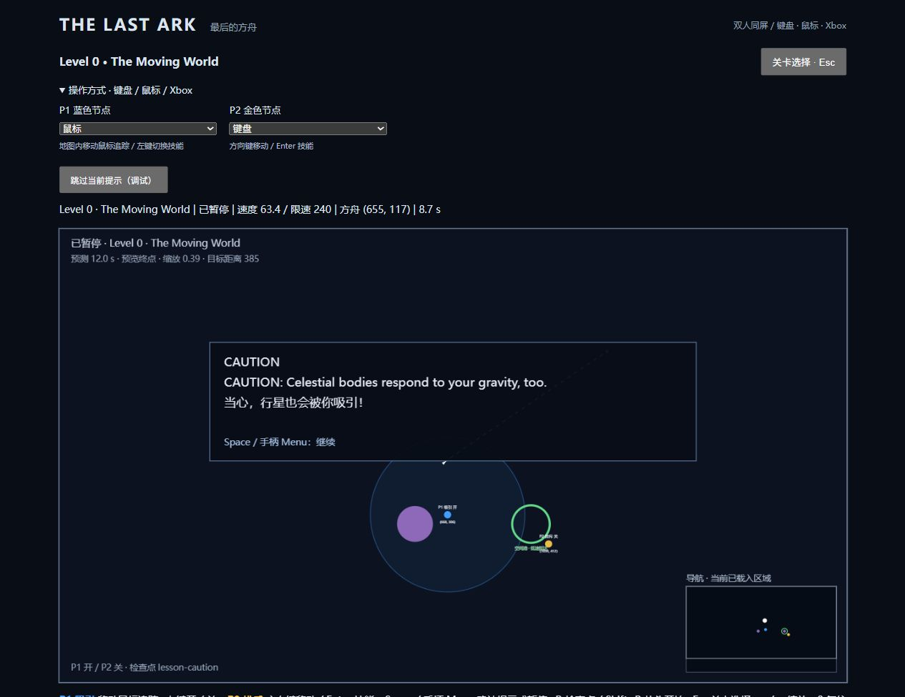
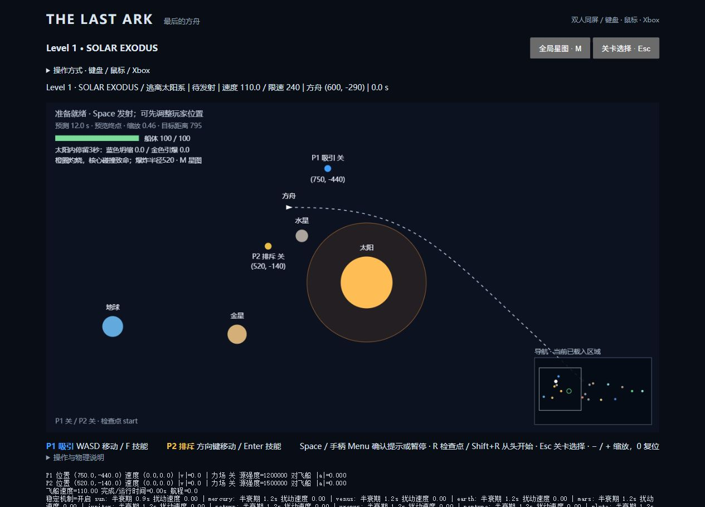
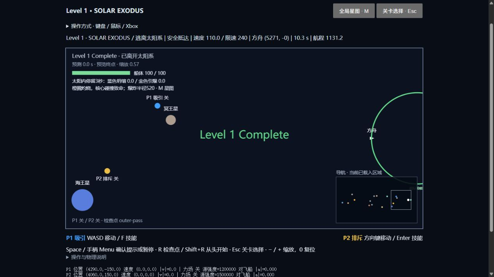
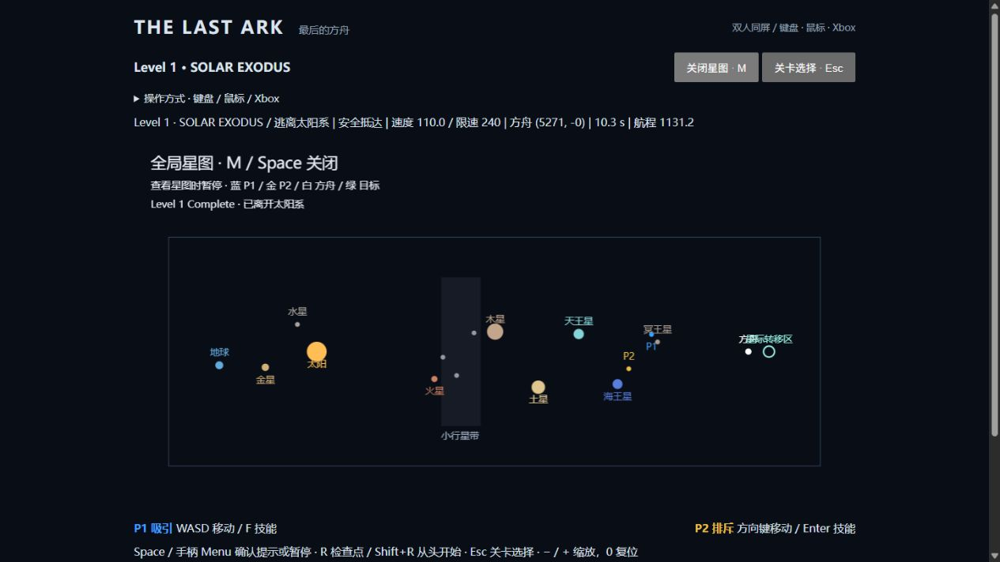
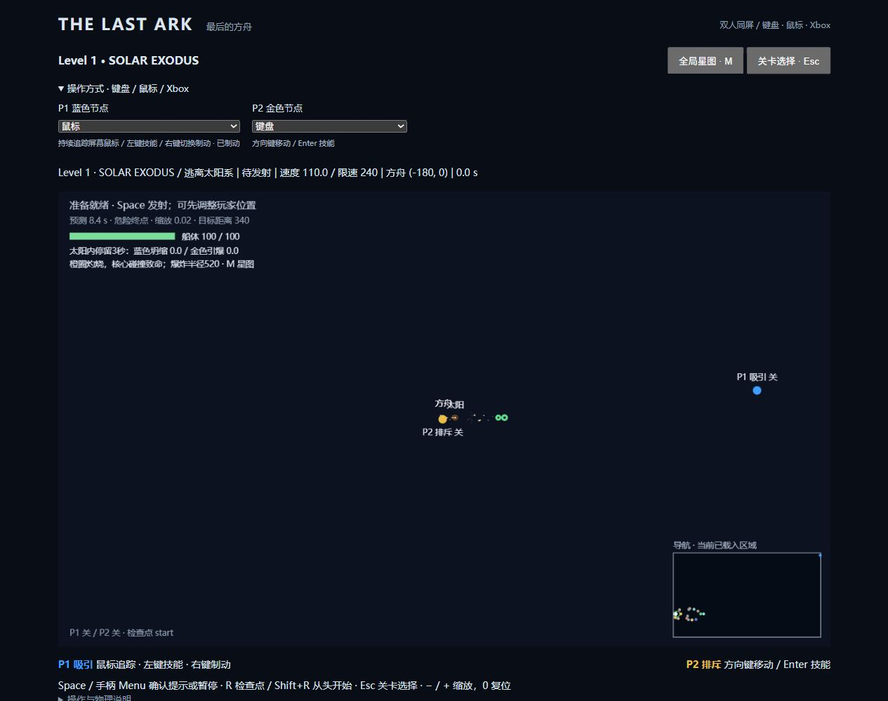
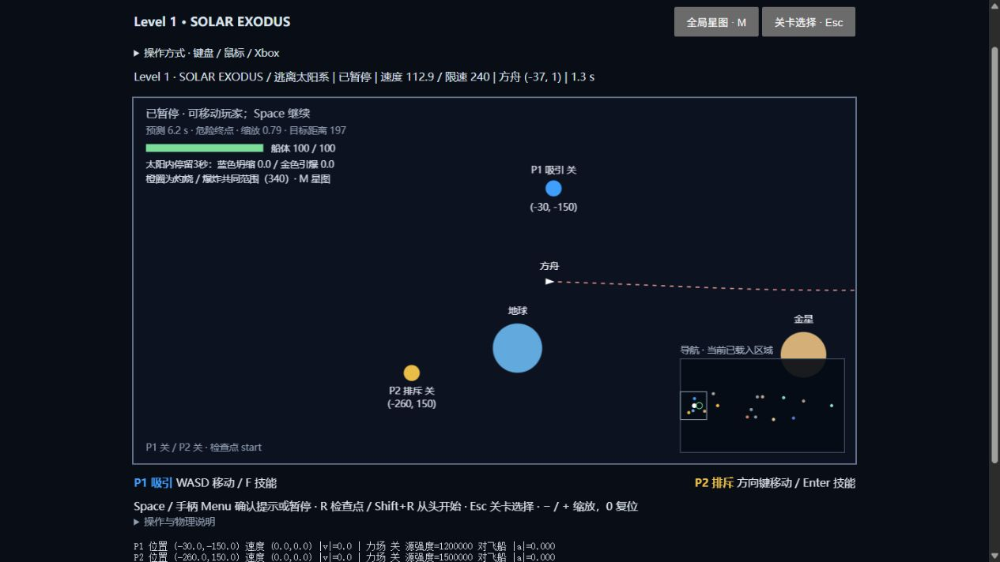

# THE LAST ARK · 最后的方舟

双人同屏的二维太空合作游戏。人类最后的移民方舟寻找家园，两名高维观察者只能移动自己的引力场投影，通过吸引与排斥护航，不能直接驾驶飞船。

目前 **Level 0 完整可玩**：First Contact → 虫洞 → The Moving World → 行星避障 → 低速空间站入港 → Level 0 Complete。保留原试玩“绕行与制动”和开发合作测试场景。现在还可继续游玩 **Level 1：Solar Exodus**，黑洞与无限探索仍未制作。路线与架构契约见 [GAME_DESIGN.md](docs/GAME_DESIGN.md)。

## 安装与启动

```bash
git clone https://github.com/nathancao321-source/the-last-ark.git
cd the-last-ark
npm install
npm run dev
```

打开终端显示的地址（默认 http://127.0.0.1:5173/，占用时自动换端口；当前本机试玩为 http://127.0.0.1:5174/）。点击 First Contact 开始，序章完成后可继续 Solar Exodus；也可从关卡选择直接进入太阳系、第二部分或原试玩。无需账户、服务器、外部素材或 AI。MIT License。

```bash
npm test           # 自动化测试
npm run test:watch
npm run build      # TypeScript 严格检查 + Vite 生产构建
npm run preview    # 预览生产构建
npm run check      # 测试 + 构建
```

本地验证环境：Windows、Node.js 24.20.0、npm 11.19.0。依赖由 package-lock.json 锁定，CI 使用 npm ci；开发服务只监听本机。

## 实际操作方式

展开“操作方式”，为 P1 / P2 分别选择设备。默认保留双键盘，可以使用键盘+Xbox、鼠标+Xbox、鼠标+键盘或两个手柄。一个鼠标/同一个手柄不可同时分配给两名玩家。

| 设备 | 移动 | 技能开关 |
| --- | --- | --- |
| P1 键盘 | WASD | 点按 F |
| P2 键盘 | 方向键 | 点按 Enter |
| 鼠标 | 持续追踪鼠标所指的屏幕位置；右键点按切换制动 | 左键点按 |
| Xbox / 标准映射手柄 | 左摇杆（回中死区 0.25，重新启动阈值 0.30，保留模拟量） | A 点按 |

- 技能都为按一下开、再按一下关，移动时始终可用。两个力场按矢量叠加，也影响可受力行星与陨石。
- 手柄选择的是浏览器的第 1 / 第 2 个设备槽。连接后可能需要先按一下按钮让浏览器识别；新连接、重新获得焦点或换源后，先松开摇杆和按钮回中立。界面显示连接/映射状态；断连关闭该手柄技能并输出中性意图，节点正常制动。只接收 `mapping="standard"`，未做任意品牌重映射或震动。
- 鼠标每个固定步都把当前屏幕指针重新转换为世界目标，镜头移动/缩放时也持续追踪。在地图上开始追踪后可以把指针移出 Canvas。**右键点一下制动，再点一下恢复追踪**，松开右键、移动鼠标不会取消制动；左键技能仍可独立使用。制动走原有有限减速度，绝不瞬停或传送。界面显示“已制动 / 追踪中”。这按最新操作需求替代旧版锁定世界目标模式。
- 换设备只清理该玩家的旧输入，不突变物理速度；失焦自动暂停并释放方向/目标。页面重载后设备选择恢复默认键盘。

| 通用操作 | 按键 |
| --- | --- |
| 确认地图上的教学文本 | Space / 手柄 Menu |
| 无教学文本时开始、暂停、继续 | Space / 手柄 Menu |
| 从当前检查点重试并关闭两技能 | R |
| 当前关卡完全重开 | Shift+R |
| 返回关卡选择 | Esc |
| 调整最大近景缩放 / 默认值 | − / +（等号键）/ 0 |
| 全局星图（打开时冻结模拟，关闭后恢复之前状态） | M / 星图按钮 |

教学文字直接画在地图上，每次一条，约 **0.45 秒浮现**；确认后约 **0.30 秒消失**，淡出结束才执行该步确认/继续。讲解期间普通天体暂停，两个节点仍能正常部署。没有提示时 Space 立即正常暂停。没有强制时间限制。

## Level 0：完整通关路线

### 第一部分 · First Contact

方舟从 (120,360) 出发，初速度 (45,0)。虫洞中心 (760,80)、半径150，船中心进入即可，不限制低速；完全不操作会错过虫洞并最终出界。无行星或障碍。

提示依次为：开场剧情、P1 移动、开启吸引、观察弯曲、P2 移动、开启排斥、观察双场叠加、惯性护送。**每条新提示先按 Space 让文字淡出，再操作；新提示出现时不要把 Space 连按成暂停。**

可复现双键盘路线：

1. P1 轻按 D 约 0.15 秒，松开后等节点停稳；按提示点 F 开吸引。
2. 确认“观察引力”，实际吸引约0.65秒后自动暂停并显示 P2 提示。
3. P2 轻按右方向约0.15秒，松开等停稳；按提示点 Enter 开排斥。
4. 确认“两场叠加”，约0.65秒的有效双场作用后出现最后一条提示。
5. 按 F / Enter 关闭两场，确认预测为绿色场景出口，再确认提示继续惯性飞行。实际入洞自动进入第二部分。

测试分别使用6/8/10/12/14个固定步（0.10–0.23秒）的两人移动，**25种组合均成功**。所有路线只用正常移动、场开关和暂停；无瞬移或改写飞船速度。教学不是出口门锁，提前真实入洞也合法。

### 第二部分 · The Moving World

方舟 (120,340)、初速度 (65,0)；行星 (550,340)、半径65、初速度0、运动响应0.18；空间站 (970,340)、半径68。行星具备按体积计算的自身引力，真实参与积分、碰撞、玩家力场与选择性稳定，移动比飞船困难。没有小行星带、预设行星动画或关卡专用坐标修改。

首次累计到足够明显的玩家扰动速度（≥2世界单位/秒）时，会显示：

> CAUTION: Celestial bodies respond to your gravity, too.
> 当心，行星也会被你吸引！

空间站无实体碰撞或捕获锁定；方舟必须完整进入圆环、速度 **≤48世界单位/秒** 才成功。超速接近/经过会明确显示 **TOO FAST TO DOCK**，仍继续真实飞行，可以减速转回再试。危险行星碰撞优先判失败。

已验证路线（允许暂停部署，坐标可通过节点标签或开发数据查看）：

1. P1 保持 (350,160)，把 P2 部署到约 (1050,420)，等节点停稳。
2. 确认开场和移动世界提示，开启蓝场引导方舟从行星上方绕行。行星受力警告出现时，确认警告及入港提示后继续。
3. 飞船到 x≈420 时关蓝场，惯性前进到 x≈650 后暂停。
4. 把 P1 移到 (690,320) 附近，开蓝场、继续一小段以转向空间站。
5. 再暂停，关蓝场、开金场检查预测。绿色“安全入港”时继续；否则微调转向时长/金场位置。自动仿真用当前航向切线投影到 x=970 时 y≈390 作为切换条件。

**9条路线通过**：蓝场初次关闭 x=410/420/430，最后转向切线 y=380/390/400。行星确实发生位移，最终速度全部≤48；无干预会撞毁。另有一次从 First Contact 起点经过真实虫洞转场、再低速入港的连续仿真。测试代码在 [moving-world.test.ts](tests/moving-world.test.ts)。

成功后显示 **Level 0 Complete**、本段实际飞行时间与航程，并记录下一章解锁。仅此解锁标记保存到本地浏览器；检查点不跨刷新保存。Solar Exodus 仍标记“内容开发中”，不会启动空关卡。

每段新提示保存当前真实世界检查点；R 恢复当前阶段，重新显示提示并关闭技能。第二部分也保留绕行后的 after-bypass 检查点。Shift+R 从当前部分起点重开。无教学卡死的强制机关；开发模式还可跳过当前提示，但不自动完成物理目标。

## Level 0 验收记录（上阶段）

- `npm run check`：**213项测试、15个文件通过**，严格类型检查及生产构建通过。
- 保留原试玩30条、开发合作6条路线回归；新增 First Contact 25条、Moving World 9条及完整序章连续通关。
- 测试覆盖真实力场影响、提示顺序、提前入洞、暂停与检查点重试、预测不改变实况、行星移动、超速入港后离开/低速返回、章节解锁与存储失败容错。
- 输入测试覆盖当时的鼠标世界目标锁定、有限加速度、混合来源；标准 Xbox 报文、摇杆死区、A/Menu边沿、断连/重连、失焦回中立。淡入/淡出时长及单次确认有自动测试。
- 浏览器实际运行已检查设备独立选择、鼠标追踪与左键开关、未连接手柄的中性状态、键盘切换、暂停/检查点恢复、真实行星扰动触发双语警告及地图提示推进。完整序章通关以自动仿真为依据，本轮浏览器未完整重走最终入港；**模拟手柄测试不等同于 Xbox 实体硬件验收**。真实双人键盘多键冲突、手柄驱动/浏览器兼容性、摇杆死区与长时间手感仍需人工试玩。



## 结构与扩展点

```text
src/
  camera/    世界/屏幕变换、三人取景、三人中心平滑跟随、导航
  scenes/    场景注册、显式转场、场景与游戏阶段分层
  game/      状态、任务触发器、教学、恒星危害/变换、检查点、固定时钟、预测
  physics/   独立节点动力学、引力、Verlet积分、稳定机制、扫掠碰撞
  levels/    first-contact / moving-world / solar-system / first / cooperation
  input/     PlayerControlIntent、独立来源、键盘、鼠标、Xbox与选择界面
  render/    Canvas实体、视野裁剪、地图教学浮层、基本章节UI
  world/     空间索引、屏外来袭事件、确定性随机、未来区块接口
  debug/     参数覆盖和运动数据
```

输入只输出 `moveX/moveY/abilityActive/targetWorldPosition`，不修改实体。物理、任务与渲染分离。未来 WebGL 可以替换 render，继续消费 GameState/Camera/Trajectory；流线读取场源，尾迹读取速度，教学浮层读取教程状态。特效应保留独立时间与状态，不能回写物理。SectorProvider、种子与区块规划接口尚未接入流式加载。

## 保留的物理近似

- 固定1/60秒；每渲染帧最多补算15步。Velocity Verlet 前后两次采样天体引力，局部空间索引避免全宇宙两两计算；离屏实体仍运动，仅渲染裁剪。
- 软化距离、平滑有限范围、单源加速度上限；合加速度≤170，速度≤240。质量随球体积×密度变化。移动引力源自然产生弹弓，无额外加速奖励；允许真实束缚轨道。
- 控制节点不是普通天体，不受引力或反作用；speed=260、acceleration=650、braking=260/0.6。约0.4秒加速、0.6秒停稳，反向不突变。鼠标目标近场收敛时间0.25秒，走同一有限加速度路径。
- 行星response=0.18是游戏化响应，非严格动量守恒。当前行星玩家扰动半衰期1.2秒，陨石一般1秒；离开有效力场后0.25秒平滑增强阻尼，仅衰减记录的玩家速度分量，不清除初始漂移/环境引力，更不作用于飞船。极小扰动≤0.03可归零，没有回出生点弹簧。
- 轨道的基础运动不会被阻尼直接抹掉，但位置扰动会改变后续环境引力，**不保证回到原轨道**。硬限速也不是能量守恒。
- 预测复用同一物理，最多12秒、10Hz刷新；假定释放所有移动意图并保留技能开关，模拟节点制动。预测副本忽略教学讲解暂停，遇到碰撞、胜利或转场停止，不提前启动下一场景。
- 天体之间未做弹性碰撞；只有明确配置的任务世界边界会令方舟出界失败，屏幕边缘不是边界。

## 调试与范围

仅开发模式：`?dev=1&scene=tutorial_part_1`、`tutorial_part_2`、`prototype`、`coop_test`，以及 `?dev=1&scene=solar_system&section=earth`（section 还可选 sun / belt / pluto）。显示节点位置/速度、飞船速度、场强/实际加速度、时间、航程、行星扰动及半衰期；教学可跳过当前提示。

追加参数：`&stabilization=off` 对照纯惯性；`&halfLife.planet=0.8` 单独调整半衰期；`&moveSpeed=260&moveAcceleration=650&moveBraking=433.333333` 调整节点。无效值忽略；生产构建不启用这些覆盖。

原试玩和合作测试保留每关18秒三星、30秒二星的可选效率评价；Level0仅显示时间/航程，不施加限时评分。不能仅凭可通关路线宣称双人一定比单人更快。

| 已实现 | 尚未实现 |
| --- | --- |
| 完整Level0和Solar Exodus、双场、可移动行星、太阳危害/变换、低速停靠、章节与检查点 | 黑洞关、Endless与隐藏内容 |
| 双键盘、真实鼠标适配、Gamepad API与标准Xbox映射、独立设备选择 | 自定义按键、非标准手柄映射、震动、手机触控、联网 |
| 世界坐标/镜头/导航、局部引力、可见裁剪、确定性随机基础 | 运行中的区块加载器、程序化宇宙、远场近似 |
| 基础Canvas几何与提示浮层 | 完整存档、精美美术、音乐、粒子、WebGL、真正的全屏模式切换 |


## Level 1：Solar Exodus（2026-10-16）

从地球附近 (-180,0) 以110单位/秒起航，经太阳危险绕行、内行星、小行星带、外行星，进入唯一终点——星际转移区 (5480,0)，半径210，不要求低速入港。冥王星初始(4350,-120)，出口位于其初始位置更右侧，留有明确空隙；它不在终点圈里。已删除冥王星外的中间出口及其必经条件。玩家主动把冥王星推到终点仍是合法物理行为，不会因此把终点偷偷挪走。

太阳、水星、金星、地球、火星、木星、土星、天王星、海王星和冥王星都存在于世界和星图中。初始布局沿主要前进方向压缩排列，不是天文学比例。太阳处在地球与出口之间。阶段目标用宽广世界区域判断，绕行路线没有狭窄轨道锁定，也没有屏幕/世界出界失败。通过太阳、内行星、带区和外行星时保存检查点。完成只显示 Level 1 Complete，不进入尚未实现的下一章。

### 太阳与轨道近似

- 太阳半径100、引力范围6000、热区半径340。方舟100HP，热伤害按接近程度从0渐增至80HP/秒；触及核心直接失败。无自动回血。
- 金色节点在太阳内部连续停留3秒：太阳引爆，半径340内的方舟失败（与橙色灼烧圈同一配置，船体接触范围也计入）；其他天体没有爆炸冲量。方舟在范围外则继续；太阳消失后自然不再提供引力。
- 蓝色节点内部停留3秒：坍缩为半径32的中子星，引力强度变为1.7倍、响应提高至0.35、无热伤害。无需开启技能，只判断节点位置。两节点同时在内部则相互抵消计时；离开重置，暂停冻结计时。
- **普通行星没有推动距离上限**。初速度按同一太阳引力公式的近圆轨道速度计算，之后完全由物理积分决定位置和速度。离开有效场后，只衰减玩家速度扰动（半衰期1.2秒），不会把已改变的位置弹回轨道，也不会停止基础公转。
- 木星响应从0.18降至0.02，约难推动9倍，仍没有移动距离上限。太阳响应约为此前的12%，仍能微弱推动。太阳保留先前指定的稳定约束：response=0.003、扰动半衰期0.9秒、距初始中心最多60；中子星对应320。它与普通行星无距离限制的行为通过配置区分。
- 太阳、行星、物理小行星和飞船互相发出/接受有限范围引力，用空间索引查询附近源，不计算全宇宙两两作用。太阳系天体 `gravityResponse=1`，自然引力不被较低的玩家推动响应削弱。行星密度系数3，引力范围 `max(360,半径×8)`；太阳范围6000，外行星初速度也来自实际太阳场。背景碎石、空间站、虫洞及控制节点不参与相互引力。
- 已移除太阳系预设圆轨道驱动：没有轨道位置覆盖、回弹或重复的向心力。太阳移位、坍缩/爆炸、行星相遇都能自然改变轨迹；只衰减直接来自玩家场的速度扰动。有限范围截断、软化、加速度/速度上限、太阳位移约束仍是游戏近似，不宣称严格天体力学或长期天文稳定。

### 来袭小行星与镜头

带区包含100颗纯背景碎石、3颗实际运动陨石，另有一次2颗来袭事件，物理天体数量15→17。事件区域只负责触发时机，**生成位置使用当帧最终摄像机矩形**，整颗陨石在右侧屏幕外并留出至少180世界单位、或视野宽度15%的安全空隙。之后以55单位/秒朝出生时方舟位置飞行，不追踪、不瞬移，接受正常技能与扫掠碰撞。暂停/星图期间不刷新。

随机形状/序列由种子决定；同种子、同视野才有相同的生成位置。视野只参与“在哪里出生”，不会改变既有天体的物理积分。极度拉远时来袭路程会变长。轨迹预测包含已出生的小行星，**不预测尚未生成、依赖未来视野的来袭事件**。

镜头始终优先保留方舟与两位玩家，分散时自动拉远，没有固定的最小缩放值；聚合时缓慢拉近，默认近景上限0.8（可用 +/- 调整，最高2）。已经撤回地标取景、中央死区及弹簧缓冲，恢复三人前瞻包围盒中心的指数平滑跟随，不再切到太阳/地球/冥王星，也不显示终点镜头框。小地图与 M 星图用于查看远处天体；极远视角保留节点/方舟最小标记。

### 可行路线与验收

基础路线：先在太阳上方 y≈-600 绕行，沿 x≈450→1000→1450 前进；随后沿 y≈-620 经过 x≈2100→3000→4170，再转向唯一终点 (5480,0)。蓝场放在希望前进的一侧引导，金场从反方向推动/清障；技能会干扰附近行星，需看预测并适时关闭。可暂停部署节点。恒星变换后先暂停，把两个节点用正常操作移回飞船附近，再沿 y≈-700 留出余量，避免更强引力和受扰动水星。

- 最新 `npm run check`：**261项测试、16个文件全部通过**，严格类型检查与生产构建通过。
- 自动反馈驾驶只输出两玩家正常意图，不设置飞船/行星坐标或速度：90/100/110三个巡航策略、太阳引爆/坍缩两条路线、太阳/带区/冥王星三个分段全部完成，常规完整路线均小于90秒。它证明基础可行解，不能代替真人合作难度评估。
- 保留上阶段全部 Level0/原试玩/合作场景回归。新回归覆盖普通行星持续移动超过5000单位、松场后只减速不回位、鼠标点按锁定制动、摇杆回中后持续10秒不漂移、超宽镜头屏外出生、静止镜头无持续振荡、热伤害、变换、检查点、扫掠碰撞。
- Xbox 测试使用标准API模拟报文；本机没有接入实体Xbox进行验收。实际摇杆磨损、驱动和双人手感仍需要用户试玩。

以下太阳热区、终点、星图和远景截图为上轮界面记录，其中旧截图的爆炸数字不代表当前配置；当前统一半径为340。




此前浏览器实测包括鼠标点按制动、全局星图、恢复后的镜头、扩大热区和删除中间出口后的终点段。最新相互引力的完整太阳系主线由上述物理仿真验证，未声称已用两个真人完整通关。




远距离鼠标探索实测：P1 到达 x≈28879 后，右键点按平滑停至速度0；方舟和 P2 保持可见。




### 最新调整与水星核查

现在水星也真正接收太阳与附近天体的引力。用同一软化/截断公式计算初始切向速度 `v=sqrt(|a_sun|×r)`，随后由固定步积分自由运动。孤立太阳—水星测试600秒，轨道半径误差小于0.5%；全部天体相互作用运行90秒，水星不碰太阳、数值有限。原先依赖解析轨道的“半径几乎不变”测试已替换，不能再拿旧模型证明新系统。节点静止但技能开启仍会施力；此规则没有改变。

新增测试还比较了等时、等距离施力下木星/太阳的实际位移，并检查距太阳300单位已会掉血、180单位附近100HP不到2秒耗尽、350单位安全。原有三条完整主线、恒星变换和分段可行解仍通过。推荐玩家采用更宽的绕行余量；太阳开发起点调整到(600,-410)，避免起跑就逼近扩大后的热区。


最新引力回归：九颗行星分别实际吸引飞船且接受飞船反向引力；两行星互相加速；关闭玩家场响应不关闭环境引力；物理陨石也作为引力源；灼烧/爆炸边界相同，距太阳400单位不再被旧520范围误杀。DEV 数据新增飞船受到的天体引力向量和来源，方便关闭两技能后直接观察。261项测试、构建通过，常规三条/恒星变换两条/开发分段三条路线均重新验证。

本轮浏览器验证：地球起航，两技能始终关闭，1.28秒后飞船速度由110变为112.94，位置由(-180,0)变为约(-37,1)，环境加速度为(1.040,3.199)，来源为太阳和地球。暂停正常；HUD显示灼烧/爆炸共同半径340；浏览器没有记录到警告或错误。该检查验证自然引力实际进入运行循环，完整通关仍以上述仿真为依据。


