# THE LAST ARK · 最后的方舟

双人同屏的二维太空合作游戏。人类最后的移民方舟寻找家园，两名高维观察者只能移动自己的引力场投影，通过吸引与排斥护航，不能直接驾驶飞船。

目前 **Level 0 完整可玩**：First Contact → 虫洞 → The Moving World → 行星避障 → 低速出口虫洞跃迁 → Level 0 Complete。保留原试玩“绕行与制动”和开发合作测试场景。现在可连续游玩 **Level 1：Solar Exodus → Level 2：Beyond the Horizon / 银河深渊 → Endless：Beyond the Stars / 群星之间**。路线与架构契约见 [GAME_DESIGN.md](docs/GAME_DESIGN.md)。

## 安装与启动

```bash
git clone https://github.com/nathancao321-source/the-last-ark.git
cd the-last-ark
npm install
npm run dev
```

打开终端显示的地址（默认 http://127.0.0.1:5173/，占用时自动换端口）。封面点击「启程」从新手教程开始；「航行目录」可查看章节与解锁进度。教程 → 逃离太阳系 → 银河深渊依次解锁，三章主线完成后开放「自由回溯」与「群星之间」无限探索。已完成的章节可以重玩，教程第一部分完成后也能从第二部分接续。进度保存在当前浏览器，兼容原有存档。无需账户、服务器、外部素材或 AI。MIT License。

界面使用原创程序绘制的星空、蓝紫星云、地球与方舟，配合金色导航、章节锁定状态、操作设置弹窗和响应式布局。界面与菜单插画独立于游戏模拟；原有关卡、引力、碰撞和目标判定保持不变。设置窗口打开时暂停游戏，关闭后由玩家继续。设备入口位于右上角「操作设置」。

```bash
npm test           # 自动化测试
npm run test:watch
npm run build      # TypeScript 严格检查 + Vite 生产构建
npm run preview    # 预览生产构建
npm run check      # 测试 + 构建
```

本地验证环境：Windows、Node.js 24.20.0、npm 11.19.0。依赖由 package-lock.json 锁定，CI 使用 npm ci；开发服务只监听本机。

## 实际操作方式

点击右上角「操作设置」，为 P1 / P2 分别选择设备。默认保留双键盘，可以使用键盘+Xbox、鼠标+Xbox、鼠标+键盘或两个手柄。一个鼠标/同一个手柄不可同时分配给两名玩家。

| 设备 | 移动 | 技能开关 |
| --- | --- | --- |
| P1 键盘 | WASD | 点按 F |
| P2 键盘 | 方向键 | 点按 Enter |
| 鼠标 | 持续追踪鼠标所指的屏幕位置；右键点按切换制动 | 左键点按 |
| Xbox / 标准映射手柄 | 左摇杆（回中死区 0.25，重新启动阈值 0.30，保留模拟量） | A 点按 |

- 技能都为按一下开、再按一下关，移动时始终可用。两个力场按矢量叠加，也影响可受力行星与陨石。
- 手柄选择的是浏览器的第 1 / 第 2 个设备槽。连接后可能需要先按一下按钮让浏览器识别；新连接、重新获得焦点或换源后，先松开摇杆和按钮回中立。界面显示连接/映射状态；断连关闭该手柄技能并输出中性意图，节点正常制动。只接收 `mapping="standard"`，未做任意品牌重映射或震动。
- 鼠标每个固定步都把当前屏幕指针重新转换为世界目标，镜头移动/缩放时也持续追踪。在地图上开始追踪后可以把指针移出 Canvas。**右键点一下制动，再点一下恢复追踪**，松开右键、移动鼠标不会取消制动；左键技能仍可独立使用。制动走原有有限减速度，绝不瞬停或传送。界面显示“已制动 / 追踪中”。这按最新操作需求替代旧版锁定世界目标模式。
- 换设备只清理该玩家的旧输入，不突变物理速度；失焦自动暂停并释放方向/目标。页面重载后设备选择恢复默认键盘。

| 通用操作 | 按键 |
| --- | --- |
| 确认地图上的教学文本 | Space / 手柄 Menu |
| 无教学文本时开始、暂停、继续 | Space / 手柄 Menu |
| 从当前检查点重试（保留快照血量）并关闭两技能 | Shift+R |
| 当前关卡从初始位置满血重开 | R |
| 返回关卡选择 | Esc |
| 调整最大近景缩放 / 默认值 | − / +（等号键）/ 0 |
| 全局星图（打开时冻结模拟，关闭后恢复之前状态） | M / 星图按钮 |

教学文字直接画在地图上，每次一条，约 **0.45 秒浮现**；确认后约 **0.30 秒消失**，淡出结束才执行该步确认/继续。讲解期间普通天体暂停，两个节点仍能正常部署。没有提示时 Space 立即正常暂停。没有强制时间限制。

## Level 0：完整通关路线

### 第一部分 · First Contact

方舟从 (120,360) 出发，初速度 (45,0)。虫洞中心 (760,80)、半径150，船中心进入即可，不限制低速；完全不操作会错过虫洞并最终出界。无行星或障碍。

提示依次为：开场剧情、P1 移动、开启吸引、观察弯曲、P2 移动、开启排斥、观察双场叠加、惯性护送。**每条新提示先按 Space 让文字淡出，再操作；新提示出现时不要把 Space 连按成暂停。**

可复现双键盘路线：

1. P1 轻按 D 约 0.15 秒，松开后等节点停稳；按提示点 F 开吸引。
2. 确认“观察引力”，实际吸引约0.65秒后自动暂停并显示 P2 提示。
3. P2 轻按右方向约0.15秒，松开等停稳；按提示点 Enter 开排斥。
4. 确认“两场叠加”，约0.65秒的有效双场作用后出现最后一条提示。
5. 按 F / Enter 关闭两场，确认预测为绿色场景出口，再确认提示继续惯性飞行。实际入洞自动进入第二部分。

测试分别使用6/8/10/12/14个固定步（0.10–0.23秒）的两人移动，**25种组合均成功**。所有路线只用正常移动、场开关和暂停；无瞬移或改写飞船速度。教学不是出口门锁，提前真实入洞也合法。

### 第二部分 · The Moving World

方舟 (120,340)、初速度 (65,0)；行星 (550,340)、半径65、初速度0、运动响应0.18；出口虫洞 (970,340)、半径68。行星具备按体积计算的自身引力，真实参与积分、碰撞、玩家力场与选择性稳定，移动比飞船困难。没有小行星带、预设行星动画或关卡专用坐标修改。

首次累计到足够明显的玩家扰动速度（≥2世界单位/秒）时，会显示：

> CAUTION: Celestial bodies respond to your gravity, too.
> 当心，行星也会被你吸引！

出口虫洞只承担目标判定：完整进入圆环、速度 **≤48世界单位/秒** 才成功。超速会显示 **TOO FAST TO TRANSFER** 并直接穿过，不反弹、不自动减速，可以调整航线返回再试。危险行星碰撞优先判失败。

已验证路线（允许暂停部署，坐标可通过节点标签或开发数据查看）：

1. P1 保持 (350,160)，把 P2 部署到约 (950,450)，等节点停稳。
2. 确认开场和移动世界提示，开启蓝场引导方舟从行星上方绕行。行星受力警告出现时，确认警告及跃迁提示后继续。
3. 飞船到 x≈420 时关蓝场，惯性前进到 x≈650 后暂停。
4. 把 P1 移到 (690,320) 附近，开蓝场、继续一小段以转向出口虫洞。
5. 再暂停，关蓝场、开金场检查预测。绿色“安全跃迁”时继续；否则微调转向时长/金场位置。自动仿真从当前航向切线投影到 x=970 时 y≥370附近开始检查预测，每次仍未成功就继续短暂蓝场转向后再检查。

**9条路线通过**：蓝场初次关闭 x=410/420/430，从最后转向切线 y≥370/380/390 开始检查预测，预测成功才切换。行星确实发生位移，最终速度全部≤48；无干预会撞毁。另有一次从 First Contact 起点经过真实虫洞转场、再低速跃迁的连续仿真。测试代码在 [moving-world.test.ts](tests/moving-world.test.ts)。

成功后显示 **Level 0 Complete**、本段实际飞行时间与航程，并记录下一章解锁。仅此解锁标记保存到本地浏览器；检查点不跨刷新保存。完成后可以继续进入 Solar Exodus。

每段新提示保存当前真实世界检查点；Shift+R 恢复当前阶段，重新显示提示并关闭技能。第二部分也保留绕行后的 after-bypass 检查点。R 从当前部分起点重开。无教学卡死的强制机关；开发模式还可跳过当前提示，但不自动完成物理目标。

## Level 0 验收记录（上阶段）

- `npm run check`：**213项测试、15个文件通过**，严格类型检查及生产构建通过。
- 保留原试玩30条、开发合作6条路线回归；新增 First Contact 25条、Moving World 9条及完整序章连续通关。
- 测试覆盖真实力场影响、提示顺序、提前入洞、暂停与检查点重试、预测不改变实况、行星移动、超速入港后离开/低速返回、章节解锁与存储失败容错。
- 输入测试覆盖当时的鼠标世界目标锁定、有限加速度、混合来源；标准 Xbox 报文、摇杆死区、A/Menu边沿、断连/重连、失焦回中立。淡入/淡出时长及单次确认有自动测试。
- 浏览器实际运行已检查设备独立选择、鼠标追踪与左键开关、未连接手柄的中性状态、键盘切换、暂停/检查点恢复、真实行星扰动触发双语警告及地图提示推进。完整序章通关以自动仿真为依据，本轮浏览器未完整重走最终入港；**模拟手柄测试不等同于 Xbox 实体硬件验收**。真实双人键盘多键冲突、手柄驱动/浏览器兼容性、摇杆死区与长时间手感仍需人工试玩。


## 结构与扩展点

```text
src/
  camera/    世界/屏幕变换、三人取景、三人中心平滑跟随、导航
  scenes/    场景注册、显式转场、场景与游戏阶段分层
  game/      状态、任务触发器、教学、恒星危害/变换、检查点、固定时钟、预测
  physics/   独立节点动力学、引力、Verlet积分、稳定机制、扫掠碰撞
  levels/    first-contact / moving-world / solar-system / first / cooperation
  input/     PlayerControlIntent、独立来源、键盘、鼠标、Xbox与选择界面
  render/    Canvas实体、视野裁剪、地图教学浮层、基本章节UI
  world/     空间索引、屏外来袭事件、确定性生成、区块加载与浮动原点
  debug/     参数覆盖和运动数据
```

输入只输出 `moveX/moveY/abilityActive/targetWorldPosition`，不修改实体。物理、任务与渲染分离。未来 WebGL 可以替换 render，继续消费 GameState/Camera/Trajectory；流线读取场源，尾迹读取速度，教学浮层读取教程状态。特效应保留独立时间与状态，不能回写物理。无限模式已接入同步区块加载；SectorProvider 保留为未来异步存储适配接口。

## 保留的物理近似

- 固定1/60秒；每渲染帧最多补算15步。Velocity Verlet 前后两次采样天体引力，局部空间索引避免全宇宙两两计算；离屏实体仍运动，仅渲染裁剪。
- 软化距离、平滑有限范围、单源加速度上限；合加速度≤170，速度≤240。质量随球体积×密度变化。移动引力源自然产生弹弓，无额外加速奖励；允许真实束缚轨道。
- 控制节点不是普通天体，不受普通天体引力或反作用；黑洞通过单独配置牵引节点（见末尾）。speed=260、acceleration=650、braking=260/0.6。常规环境约0.4秒加速、0.6秒停稳，反向不突变。鼠标目标近场收敛时间0.25秒，走同一有限加速度路径。
- 行星response=0.18是游戏化响应，非严格动量守恒。当前行星玩家扰动半衰期1.2秒，陨石一般1秒；离开有效力场后0.25秒平滑增强阻尼，仅衰减记录的玩家速度分量，不清除初始漂移/环境引力，更不作用于飞船。极小扰动≤0.03可归零，没有回出生点弹簧。
- 轨道的基础运动不会被阻尼直接抹掉，但位置扰动会改变后续环境引力，**不保证回到原轨道**。硬限速也不是能量守恒。
- 预测复用同一物理，最多12秒、10Hz刷新；假定释放所有移动意图并保留技能开关，模拟节点制动。预测副本忽略教学讲解暂停，遇到碰撞、胜利或转场停止，不提前启动下一场景。
- 天体之间未做弹性碰撞；只有明确配置的任务世界边界会令方舟出界失败，屏幕边缘不是边界。

## 调试与范围

仅开发模式：`?dev=1&scene=tutorial_part_1`、`tutorial_part_2`、`prototype`、`coop_test`，以及 `?dev=1&scene=solar_system&section=earth`（section 还可选 sun / belt / pluto）。显示节点位置/速度、飞船速度、场强/实际加速度、时间、航程、行星扰动及半衰期；教学可跳过当前提示。

追加参数：`&stabilization=off` 对照纯惯性；`&halfLife.planet=0.8` 单独调整半衰期；`&moveSpeed=260&moveAcceleration=650&moveBraking=433.333333` 调整节点。无效值忽略；生产构建不启用这些覆盖。

原试玩和合作测试保留每关18秒三星、30秒二星的可选效率评价；Level0仅显示时间/航程，不施加限时评分。不能仅凭可通关路线宣称双人一定比单人更快。

| 已实现 | 尚未实现 |
| --- | --- |
| 完整Level0、Solar Exodus、银河深渊、Endless程序化探索、三恒星与星云发现、本地存档 | 更多特殊星域、隐藏空间站、程序化事件 |
| 双键盘、真实鼠标适配、Gamepad API与标准Xbox映射、独立设备选择 | 自定义按键、非标准手柄映射、震动、手机触控、联网 |
| 世界坐标/镜头/导航、局部引力、可见裁剪、有限区块缓存、浮动原点 | Worker异步生成、离线远场演化、无限历史改动持久化 |
| 基础Canvas几何与提示浮层 | 完整存档、精美美术、音乐、粒子、WebGL、真正的全屏模式切换 |


## Level 1：Solar Exodus（2026-10-16）

从地球附近 (-180,0) 以110单位/秒起航，经太阳危险绕行、内行星、小行星带、外行星，进入唯一终点——星际转移区 (5480,0)，半径110，进入速度要求≤60。冥王星初始(4350,-120)，出口位于其初始位置更右侧，留有明确空隙；它不在终点圈里。已删除冥王星外的中间出口及其必经条件。玩家主动把冥王星推到终点仍是合法物理行为，不会因此把终点偷偷挪走。

太阳、水星、金星、地球、火星、木星、土星、天王星、海王星和冥王星都存在于世界和星图中。初始布局沿主要前进方向压缩排列，不是天文学比例。太阳处在地球与出口之间。阶段目标用宽广世界区域判断，绕行路线没有狭窄轨道锁定，也没有屏幕/世界出界失败。通过太阳、内行星、带区和外行星时保存检查点。完成只显示 Level 1 Complete，不进入尚未实现的下一章。

### 太阳与轨道近似

- 太阳半径100、引力范围6000、热区半径340。方舟100HP，热伤害按接近程度从0渐增至80HP/秒；触及核心直接失败。无自动回血。
- 金色节点在太阳内部连续停留3秒：太阳引爆，半径340内的方舟失败（与橙色灼烧圈同一配置，船体接触范围也计入）；其他天体没有爆炸冲量。方舟在范围外则继续；太阳消失后自然不再提供引力。
- 蓝色节点内部停留3秒：坍缩为半径32的中子星，引力强度变为1.7倍、响应提高至0.35、无热伤害。无需开启技能，只判断节点位置。两节点同时在内部则相互抵消计时；离开重置，暂停冻结计时。
- **普通行星没有推动距离上限**。初速度按同一太阳引力公式的近圆轨道速度计算，之后完全由物理积分决定位置和速度。离开有效场后，只衰减玩家速度扰动（半衰期1.2秒），不会把已改变的位置弹回轨道，也不会停止基础公转。
- 太阳系节点响应按体积缩小：`min(0.0125, 0.005×(40/radius)^3)`，地球0.005、土星约0.00102、木星约0.00058；小行星仍为1，教学行星仍为0.18。普通行星仍没有推动距离上限。太阳保留稳定约束：response=0.0001、扰动半衰期0.9秒、距初始中心最多60；中子星对应320。它与普通行星无距离限制的行为通过配置区分。
- 太阳、行星、物理小行星和飞船互相发出/接受有限范围引力，用空间索引查询附近源，不计算全宇宙两两作用。太阳系天体 `gravityResponse=1`，自然引力不被较低的玩家推动响应削弱。行星密度系数3，对船/小行星引力范围 `max(360,半径×8)`；同组行星之间另外限制中心距离300，平滑衰减至零；太阳范围6000，外行星初速度也来自实际太阳场。背景碎石、空间站、虫洞及控制节点不参与相互引力。
- 已移除太阳系预设圆轨道驱动：没有轨道位置覆盖、回弹或重复的向心力。太阳移位、坍缩/爆炸、行星相遇都能自然改变轨迹；只衰减直接来自玩家场的速度扰动。有限范围截断、软化、加速度/速度上限、太阳位移约束仍是游戏近似，不宣称严格天体力学或长期天文稳定。

### 来袭小行星与镜头

带区包含100颗纯背景碎石、3颗实际运动陨石，另有一次2颗来袭事件，物理天体数量15→17。事件区域只负责触发时机，**生成位置使用当帧最终摄像机矩形**，整颗陨石在右侧屏幕外并留出至少180世界单位、或视野宽度15%的安全空隙。之后以55单位/秒朝出生时方舟位置飞行，不追踪、不瞬移，接受正常技能与扫掠碰撞。暂停/星图期间不刷新。

随机形状/序列由种子决定；同种子、同视野才有相同的生成位置。视野只参与“在哪里出生”，不会改变既有天体的物理积分。极度拉远时来袭路程会变长。轨迹预测包含已出生的小行星，**不预测尚未生成、依赖未来视野的来袭事件**。

镜头始终优先保留方舟与两位玩家，分散时自动拉远，没有固定的最小缩放值；聚合时缓慢拉近，默认近景上限0.8（可用 +/- 调整，最高2）。已经撤回地标取景、中央死区及弹簧缓冲，恢复三人前瞻包围盒中心的指数平滑跟随，不再切到太阳/地球/冥王星，也不显示终点镜头框。小地图与 M 星图用于查看远处天体；极远视角保留节点/方舟最小标记。

### 可行路线与验收

基础路线：先在太阳上方 y≈-600 绕行，沿 x≈450→1000→1450 前进；随后沿 y≈-620 经过 x≈2100→3000→4170，再转向唯一终点 (5480,0)，最后约500单位航程开始制动至45左右（入区要求≤60）。蓝场放在希望前进的一侧引导，金场从反方向推动/清障；技能会干扰附近行星，需看预测并适时关闭。可暂停部署节点。恒星变换后先暂停，把两个节点用正常操作移回飞船附近，再沿 y≈-700 留出余量，避免更强引力和受扰动水星。

- 最新 `npm run check`：**331项测试、19个文件全部通过**，严格类型检查与生产构建通过。
- 自动反馈驾驶只输出两玩家正常意图，不设置飞船/行星坐标或速度：90/100/110三个巡航策略、太阳引爆/坍缩两条路线、太阳/带区/冥王星三个分段全部完成，常规完整路线均小于90秒。它证明基础可行解，不能代替真人合作难度评估。
- 保留上阶段全部 Level0/原试玩/合作场景回归。新回归覆盖普通行星弱施力持续移动超过1000单位、松场后只减速不回位、鼠标点按锁定制动、摇杆回中后持续10秒不漂移、超宽镜头屏外出生、静止镜头无持续振荡、热伤害、变换、检查点、扫掠碰撞。
- Xbox 测试使用标准API模拟报文；本机没有接入实体Xbox进行验收。实际摇杆磨损、驱动和双人手感仍需要用户试玩。

以下太阳热区、终点、星图和远景截图为上轮界面记录，其中旧截图的爆炸数字不代表当前配置；当前统一半径为340。


此前浏览器实测包括鼠标点按制动、全局星图、恢复后的镜头、扩大热区和删除中间出口后的终点段。最新相互引力的完整太阳系主线由上述物理仿真验证，未声称已用两个真人完整通关。


远距离鼠标探索实测：P1 到达 x≈28879 后，右键点按平滑停至速度0；方舟和 P2 保持可见。


### 最新调整与水星核查

现在水星也真正接收太阳与附近天体的引力。用同一软化/截断公式计算初始切向速度 `v=sqrt(|a_sun|×r)`，随后由固定步积分自由运动。孤立太阳—水星测试600秒，轨道半径误差小于0.5%；全部天体相互作用运行90秒，水星不碰太阳、数值有限。原先依赖解析轨道的“半径几乎不变”测试已替换，不能再拿旧模型证明新系统。节点静止但技能开启仍会施力；此规则没有改变。

新增测试还比较了等时、等距离施力下木星/太阳的实际位移，并检查距太阳300单位已会掉血、180单位附近100HP不到2秒耗尽、350单位安全。原有三条完整主线、恒星变换和分段可行解仍通过。推荐玩家采用更宽的绕行余量；太阳开发起点调整到(600,-410)，避免起跑就逼近扩大后的热区。


上一轮引力回归：九颗行星分别实际吸引飞船且接受飞船反向引力；两行星互相加速；关闭玩家场响应不关闭环境引力；物理陨石也作为引力源；灼烧/爆炸边界相同，距太阳400单位不再被旧520范围误杀。DEV 数据新增飞船受到的天体引力向量和来源，方便关闭两技能后直接观察。261项测试、构建通过，常规三条/恒星变换两条/开发分段三条路线均重新验证。

本轮浏览器验证：地球起航，两技能始终关闭，1.28秒后飞船速度由110变为112.94，位置由(-180,0)变为约(-37,1)，环境加速度为(1.040,3.199)，来源为太阳和地球。暂停正常；HUD显示灼烧/爆炸共同半径340；浏览器没有记录到警告或错误。该检查验证自然引力实际进入运行循环，完整通关仍以上述仿真为依据。


### 本轮修正：行星扰动、重开与终点

- 太阳系行星之间只在中心距离小于300时互相吸引；采用 `gravityPeer` 配置，同组取双方较小半径，并沿用软化与平滑衰减。对船/陨石的原引力范围和太阳的6000范围保留。不是关闭行星自身引力，也不是用轨道位置覆盖抵消力。
- 大行星节点响应明显降低，尤其土星从0.18降至约0.00102；太阳从0.003降至0.0001。陨石不削弱，太阳坍缩后的中子星响应仍为0.35。无普通行星距离锁；持续施力依然能改变轨道、移走行星。
- **R 满血从当前关卡初始配置重开**：实体位置/速度、节点、血量、计时、目标、波次和恒星状态全部恢复。**Shift+R 恢复检查点**，明确保留快照时的血量；开发分段重开回到所选分段的起点。
- 星际转移区半径210→110，入区速度必须≤60；超速显示 TOO FAST TO TRANSFER，不扣血、不锁船，可以飞离再返回。
- 本轮270项测试和构建通过。蓝/金节点分别向内干扰土星3秒，再跑满300秒，土星与木星的日心距离差始终大于300，对照轨迹偏差小于30；同样施力3秒土星偏移小于1、陨石大于100。另测近场互吸/300边缘连续归零、四种游戏状态下真实R按键恢复、终点超速离区与低速返回。全部太阳系完整/变换/分段路线加入终点制动后仍通过；旧教学回归保留。

浏览器实际按键检查：无干预飞行7.52秒后在(795,12)失败，船体44.1/100；按R后回到(-180,0)、100/100、计时/航程归零、两技能关闭、太阳回到初始状态。页面无警告/错误日志。土星扰动及完整终点制动路线使用上述自动物理仿真验证，未声称完成真人双人试玩。

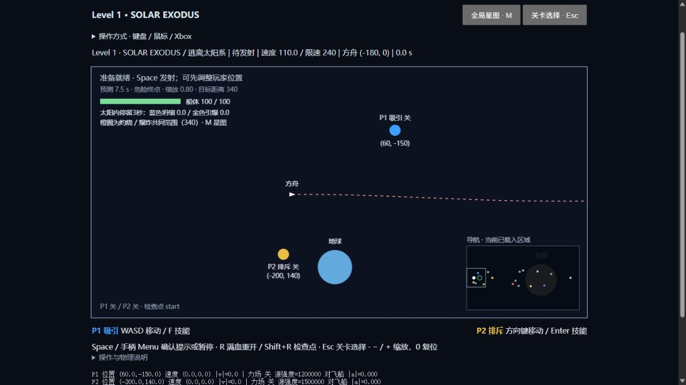


## Level 2：BEYOND THE HORIZON / 银河深渊

离开太阳系后，点击“远距跃迁”进入银河中心附近。Sagittarius A* 是游戏化版本，**软化牛顿引力＋范围截断＋潮汐伤害，不是广义相对论模拟**。黑洞不是出口；方舟必须绕行，抵达右侧独立航道。

- 普通入口：关卡选择 → 银河深渊；或完成 Solar Exodus 后继续。初始方舟(0,0)，速度(85,0)，黑洞(1300,0)。无干预直线飞行会失败。
- 黑洞：静态、不可推拉；引力强度5,000,000，软化距离130，外圈1600，天体沿用单源/合力上限170与速度上限240。控制节点有独立的强牵引及捕获重组机制；自由节点技能仍能在移动中使用。
- 三层区域：紫色虚线为引力截止边缘；红圈半径360，船体接触后开始线性增加的潮汐伤害，最高45HP/秒；事件视界半径100，船体触及即撕碎。扫掠碰撞覆盖高速穿越和初始重叠，死亡优先于出口判定；残骸越过视界也会被移除。
- 三块残骸真正参与引力、惯性、技能和碰撞。初始切向速度按同一黑洞引力公式计算，之后不覆盖位置；它们不会在玩家赶到前全部掉入黑洞。玩家扰动半衰期1秒，初始运动和自然引力不被阻尼。
- 银河出口(3100,0)、半径130、进入速度≤65，位于黑洞引力外。超速提示，不捕获/锁船。过黑洞后保存 `beyond-horizon` 检查点；R满血重开本关，Shift+R恢复真实检查点。
- 通关显示 Level 2 Complete，点击继续进入 `endless` 群星之间。原 `galactic_rest` 安全休整场景保留兼容；无限模式也可从章节选择独立进入。

### 可复现路线与验证范围

自动化反馈驾驶只输出两名玩家的普通 `PlayerControlIntent`（通过已有有限加速度移动与技能开关），不会设置飞船/残骸位置或速度。已验证的上方路线为：

`(450,-580) → (1050,-620) → (1700,-620) → (2200,-520) → (2630,-150) → (3100,0)`

下方存在漂流残骸，使用更宽路线：`(450,760) → (1050,800) → (1700,800) → (2200,700) → (2630,150) → (3100,0)`。

两侧分别以75/90/105巡航，最后一段制动至45附近；**6条路径都满血、90秒内通关**。蓝场放在期望加速度方向，金场从相反侧推；两场需同时考虑黑洞和残骸。可以暂停部署节点、观察轨迹，无倒计时或极短按键窗口。不强制检测两人是否按过技能，也没有证明单人一定无法通关；合作收益与真人手感仍需试玩。

开发入口：`?dev=1&scene=black_hole`。可选 `&section=horizon` 从绕行附近开始，`&section=escape` 从出口前以45速度开始。仅开发配置改变出生点，普通关卡与通关过程不使用这些预设。

最新300项测试/17文件及构建通过。新增固定黑洞、船/残骸吸引、有限数值、三圈伤害、不可逃离视界、高速扫掠、残骸吞噬与60秒可操作性、暂停/预测/重试、六条真实航线、检查点续关、章节衔接与旧存档兼容测试。原Level0、太阳系、键盘/鼠标/手柄报文回归全部通过。

浏览器实测：普通起点无干预约11.07秒后触及视界失败（尚有69.8HP，不能逃出），残骸仍存在；R恢复(0,0)/100HP/0秒。开发出口分段以45速度自然航行2.68秒完成，显示Level 2 Complete，点击继续成功进入银河边缘休整；返回菜单后黑洞关可选、Endless禁用。检查了吸积盘、危险圈、HP、完成按钮和休整提示，未记录浏览器警告/错误。**这不是浏览器完整双人通关记录**；完整路线以六条自动物理驾驶为依据，实体手柄和真人合作仍待试玩。

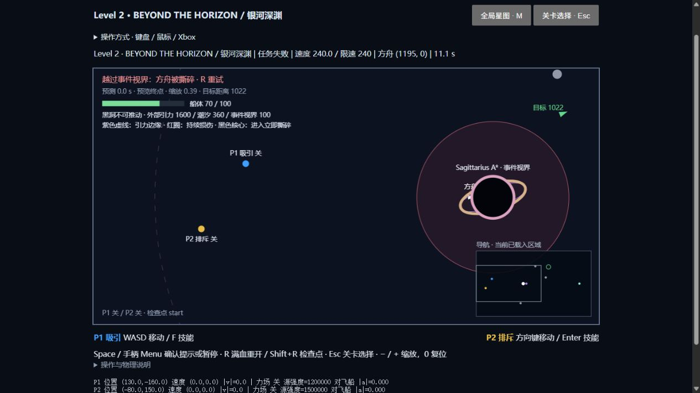
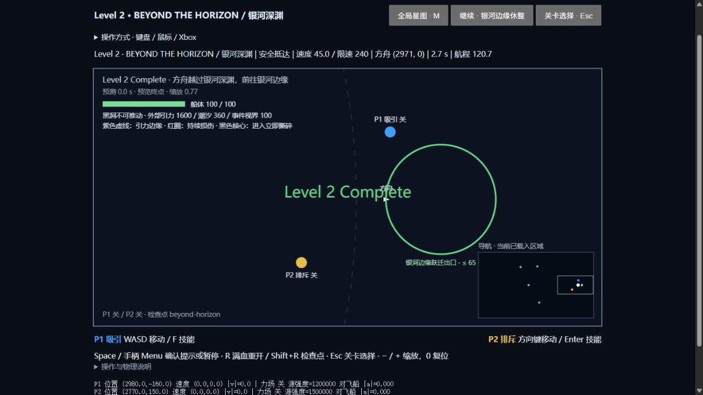
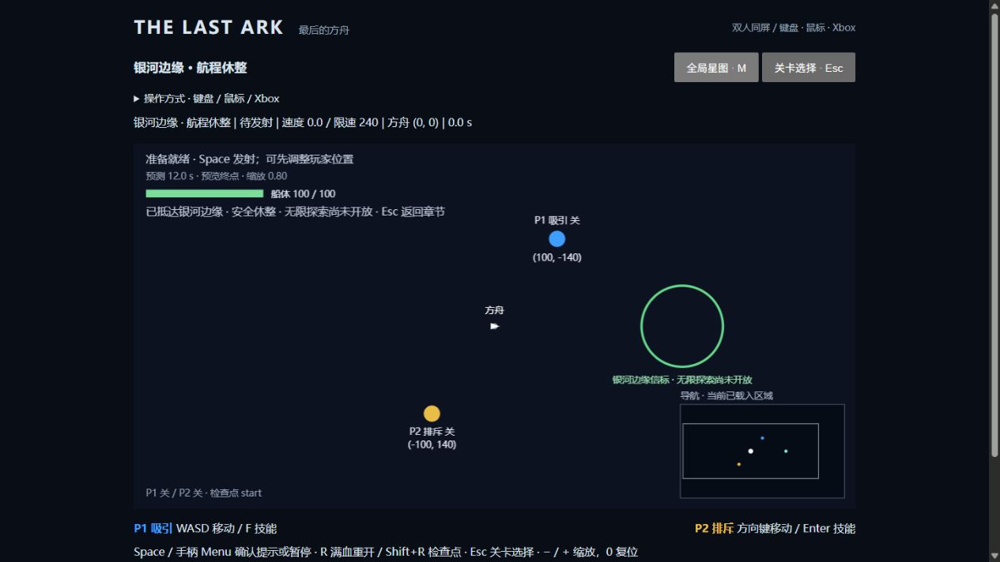

## 黑洞节点牵引、周期喷流与重组（2026-10-17）

- 黑洞对节点使用同一平滑引力公式，再乘8；两名玩家合计所受黑洞加速度各自不超过其操纵加速度的85%（默认552.5）。防御上限90%，多个黑洞叠加也不能超过；这不是整个引力区恒定85%。响应时间0.4秒使牵引不会被速度控制器每帧完全抵消，靠近视界时必须主动向外逃离。自由移动限速仍260，普通太阳/行星不牵引节点。
- 黑洞按关卡模拟时间在第5、10、15…秒向上喷流，持续0.8秒；**无人被捕获时也有纯视觉喷流，不伤害、不推动飞船或其他天体**。
- 节点触碰事件视界即失去控制和力场，显示约0.4秒撕碎收拢动画；等待下一次周期喷流，不是每人另外等满5秒。喷流已经开始时才进入的节点等下一班。随后向上喷至中心上方620世界单位，两人水平错开48，额外用0.45秒碎片聚合重组；完成后恢复控制和所选技能开关。飞船仍在进入视界时立即失败，不能借此逃生。
- Space 冻结喷流时钟和全部捕获/重组动画；自由节点保留暂停部署。R 从关卡起点完整重置；Shift+R 恢复检查点的全局周期和节点阶段。预测使用同一过程。喷流及重组是高维投影的游戏设定，并非真实黑洞物理。
- DEV `?dev=1&scene=black_hole&section=capture`：飞船安全停在远处、两个节点从视界内开始，用于观察整个流程；普通关卡不会如此出生。

验证：315项测试/18文件及生产构建通过。包括加速度总和限幅、两个节点贴近视界仍可向外脱离、近场松手2秒内被捕获、全局周期/迟到等待下一班、0.45秒重组、暂停、重试、预测、30/60/144帧一致性；原六条黑洞完整路线及旧教学/太阳系/输入回归全部通过。浏览器实际检查5秒喷出、5.83秒重组阶段、6.30秒两人的F/Enter技能恢复、10.35秒无载人喷流以及R重置，未记录警告/错误。85%的紧迫感仍需真人双人试玩，不把自动路线当作手感结论。

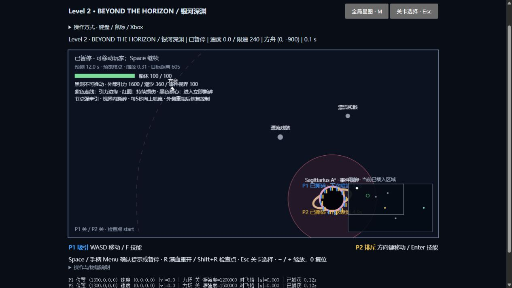
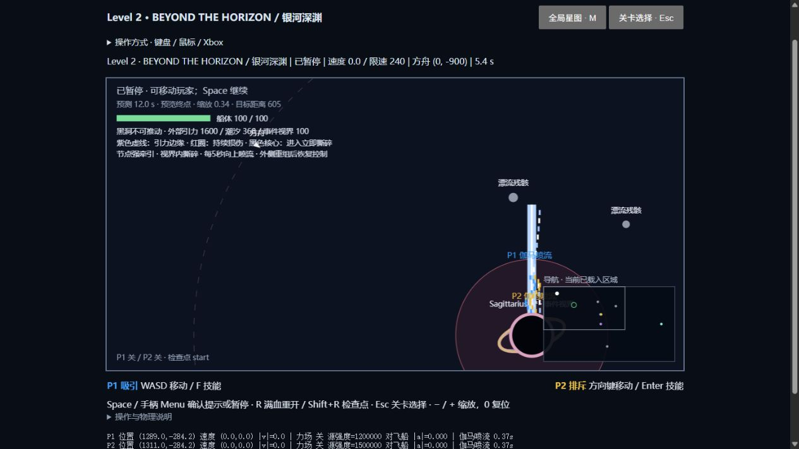
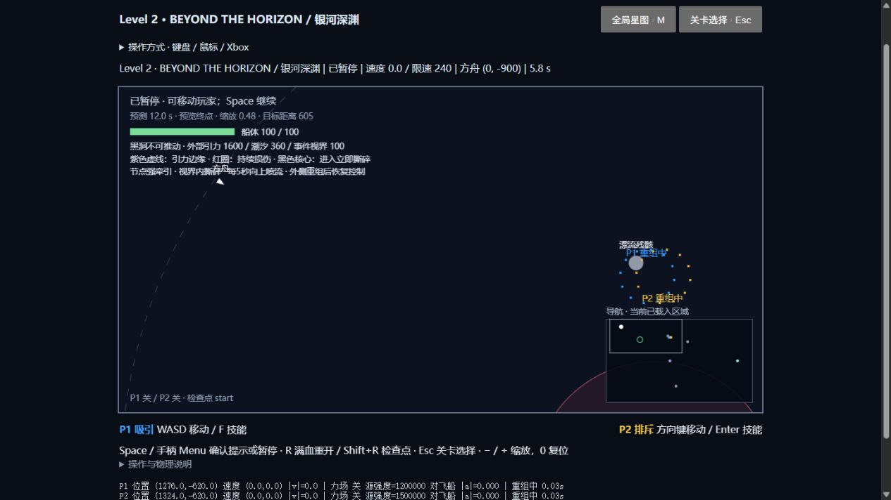
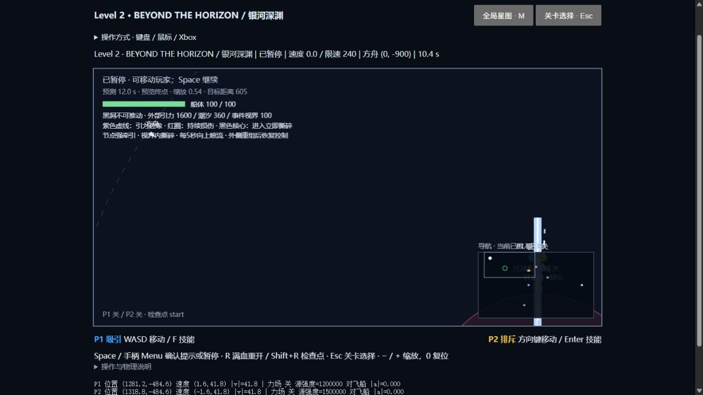

## Endless：BEYOND THE STARS / 群星之间（2026-10-17）

从关卡选择进入，或在银河深渊完成后继续。默认 Seed **20261017**，也可在菜单/探索上方输入整数 Seed，点击“开始新探索”。无最终目的地、倒计时或三星评分；飞船从90的初速度开始，只受现有物理和两位玩家能力影响，碰撞仍会失败。

操作：原双键盘、鼠标、Xbox选择保持。**H / J**分别将P1 / P2召回飞船旁，仅重置被召回节点的输入并匹配船速，不修改飞船位置/速度。**K**或按钮保存，**L**或按钮恢复；恢复后暂停、技能关闭，Space继续。**R**从当前Seed的起点满血重开；**Shift+R**恢复当前检查点（加载存档后为该存档）。M显示附近已加载星域、最近发现和两个彩蛋的坐标线索。画面坐标显示的是浮动原点下的局部坐标，星图/HUD的区块坐标保持稳定。

### 有限资源与物理近似

- 区块边长2048，生成由Seed与完整整数区块坐标哈希决定，支持负坐标，不依赖加载次序或镜头。初始模板、颜色、大小和背景返回一致；运动状态本来就会随时间/施力变化。
- 方舟和两节点各加载3×3邻域，通常9–27块。附近仍有被推走天体时暂留其来源块，**总上限54块，每块最多6个物理天体，含方舟最多325个**；背景最多594个基本圆点/星云片，不参与物理。远处卸载，不持续计算全宇宙。
- **只保留最近32个卸载区块的动态快照**，卸载期间冻结；超出缓存后遗忘玩家改动，下次以种子模板的初始位置和初速度重建，不补算离线公转。发现记录保留最近64条。不是无限历史持久化。存档是单个浏览器本地槽，内容上限200万字符，不依赖服务器；清除站点数据会失去存档。
- 飞船局部坐标达到8192时按整区块搬移计算原点，实体、轨道中心、镜头、鼠标目标及预测坐标一起转换；不改变速度、航程和碰撞关系。全局地址用整数区块+局部位置表示；存档支持区块绝对值至2^40，远超本阶段可实际航行尺度，但不声称数学意义的无限精度。
- 最大生成引力范围750，小于邻域边长；继续使用空间索引、软化、加速度/速度限幅及扫掠碰撞。初始天体与区块边界至少留440单位间隔；起点块无危险体。极端情况下，重载的受扰动天体与方舟重叠，会先以空心轮廓无害等待，安全分离后才恢复物理，避免加载即死亡。
- **恒星、行星、小行星、飞船均接收附近天体引力**，环境响应为1；恒星/行星仍保留较弱的玩家响应，两者独立。普通游星以距恒星300的对置初态生成；三恒星以距中心180、相位相差120°生成。初始切向速度由实际软化/截断引力计算，此后完全由原有积分器推进，没有解析轨道、回位或额外向心力。引力源被移走/破坏，原有轨道便会改变。三恒星场半径750、普通恒星720、行星400。
- 旧探索存档加载时也启用相互引力、移除解析轨道，同时保留实际位置和速度（含缓存）；旧初速度不被强制校准，因此轨道可能自然改变。若想体验本次校准的初始星系，按R重新开始探索。有限范围、软化、独立场强和速度上限仍是游戏近似，不保证长期天文轨道稳定；背景星点/星云不参与物理。
- 两个节点均可持续吸引/排斥无限模式的物理天体。玩家耦合配置位于 `ENDLESS_NODE_RESPONSE`：恒星 `0.008×(60/r)^3`，限定0.004–0.02；行星 `0.04×(25/r)^3`，限定0.012–0.09；小行星保持1。环境引力响应仍为1，不随节点耦合缩小。此前恒星0.0005/0.001的响应过弱，现已调高，保存的活跃天体与缓存也会在恢复时更新。技能有效作用期间不启用额外阻尼，脱离后只衰减玩家注入的速度。主线太阳/行星和节点自身技能强度不变。
- 无限模式预测最多3秒、约2.5Hz更新，包含同一确定性加载和碰撞，控制主线程开销；旧关卡仍12秒/10Hz。镜头保留原来的方舟与两节点共同取景，小地图只显示附近已加载内容。

### 可找到的彩蛋

默认Seed下，三日系统位于区块 **(3,0)**，遥远紫色星云位于 **(13,-3)**，中心分别为全局 **(7168,1024)**、**(27648,-5120)**。任一节点或方舟靠近中心750单位内会发现并记录；不是需要隐藏按键的机关。其他Seed的对应地址在M星图显示，宇宙中还有小概率额外三日系统。

可行探索路线：沿y≈0航行至x≈6444，转向(6444,1024)发现三日系统；回到(6444,0)，沿横向走至(26724,0)，沿区块边缘向上飞到(26724,-5120)，再靠近(27024,-5120)发现星云。新接触系统会使小行星相撞偏转，因此这段路线给碎石群留下更大余量。提前制动转弯，查看预测，必要时暂停部署或H/J召回。自动反馈驾驶只输出两人正常移动意图/技能开关，按这条路线实际从起点依次发现两处、全程满血，没有设置飞船位置或速度。真人不必照此航线，可自由探索。

开发入口：`?dev=1&scene=endless&seed=20261017`；加`&section=triple`或`&section=nebula`可从彩蛋附近安全开始，供独立视觉/物理测试，正式探索不自动传送。

### 验证与未实现项

初次无限模式交付 **331项测试 / 19文件、严格类型检查与生产构建通过**。新增16项测试覆盖500组生成间隔、1000组分散区块加载/卸载的数量与存档上限、缓存扰动恢复和淘汰重建、30区块/61440单位的固定步连续航行、2^35区块坐标下原点转换、预测/鼠标目标/碰撞、双方独立召回、腐坏存档拒绝、三日轨道60秒稳定性与真实引力，以及两处彩蛋的完整输入驾驶路线。教学、太阳系、黑洞六条绕行路线和现有输入测试均通过。

相互引力修复后：**374项测试 / 21文件与生产构建通过**。新增10项验证生成配置、飞船/小行星/行星/恒星双向受力、行星近场作用与远场截断、引力源消失后的惯性、孤立普通星系及三恒星120秒无碰撞/有限数值/半径误差小于3、旧存档活跃与缓存天体迁移。原30区块连续航行、两处发现完整输入驾驶、教学/太阳系/黑洞/碰撞回归全部通过。这是有限时间的稳定性验证，不保证受扰后三体永远不碰撞。

节点耦合跟进（2026-10-18）：**379项测试 / 21文件与生产构建通过**。新增5项回归，分别验证两种节点能力对普通恒星、三日恒星、行星和小行星的实际方向/位移、有效场期间不阻尼、双场加速度叠加、完整三日系统被玩家扰动以及旧存档弱响应更新。孤立恒星在距节点80、连续施力5秒的测试中移动超过3且少于35世界单位；小行星用1秒窗口，避免把之后越过蓝节点/离开金场的正常运动误判为技能失效。该轮响应调参以自动化物理测试验收，最终推拉手感仍需真人试玩。

浏览器在三日开发入口关闭双技能运行40.87秒：方舟由静止受自然引力运动至(7616,785)、速度24.78，血量100；暂停与R重开正常，无控制台警告/错误。此检查验证实际页面运行，天体之间双向受力由自动化物理测试确认；未代替真人双人/实体手柄长时间试玩。

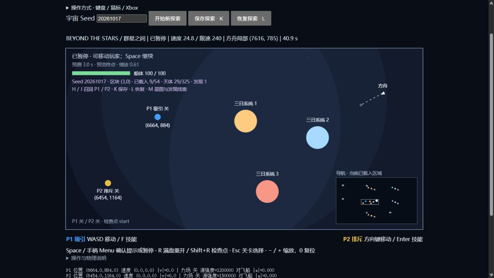

浏览器实测：正常起点飞行、H/J召回、2.10秒/189单位处保存、R后恢复同一位置/速度/暂停状态、M星图、三日系统运行时无技能也改变船速、紫色星云发现提示，未记录控制台警告/错误。截图如下。长距离与资源上限由自动仿真验证，**没有把对象数量上限当作实际浏览器堆内存分析，也没有宣称完成真人数小时连续双人试玩**。

已预留：生成器可扩展新星域类型，区块元数据可承载事件，SectorProvider可接异步存储/Worker。尚未实现特殊黑洞星域、隐藏空间站、程序化事件、永久全历史发现档案、离线远场演化或高级美术特效。

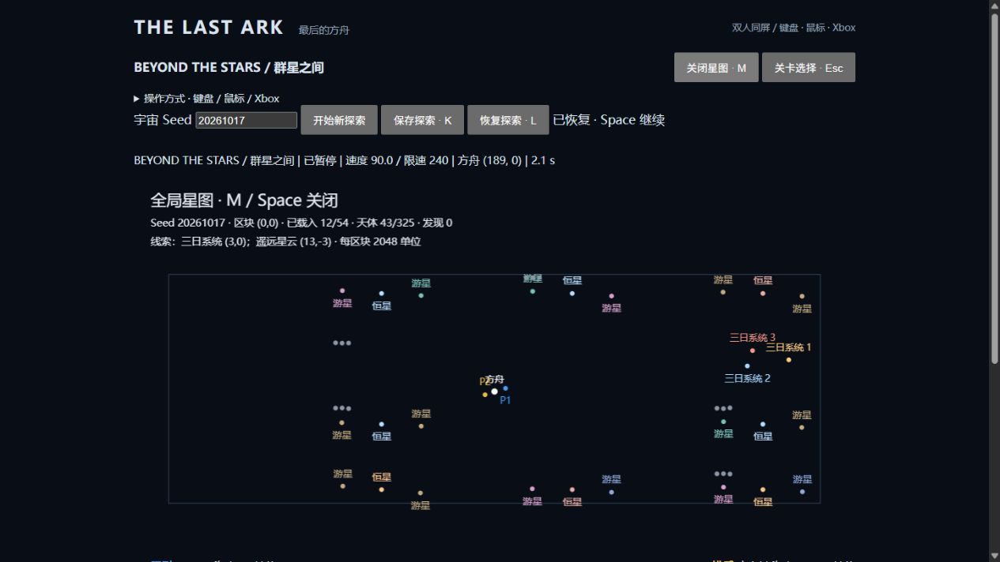
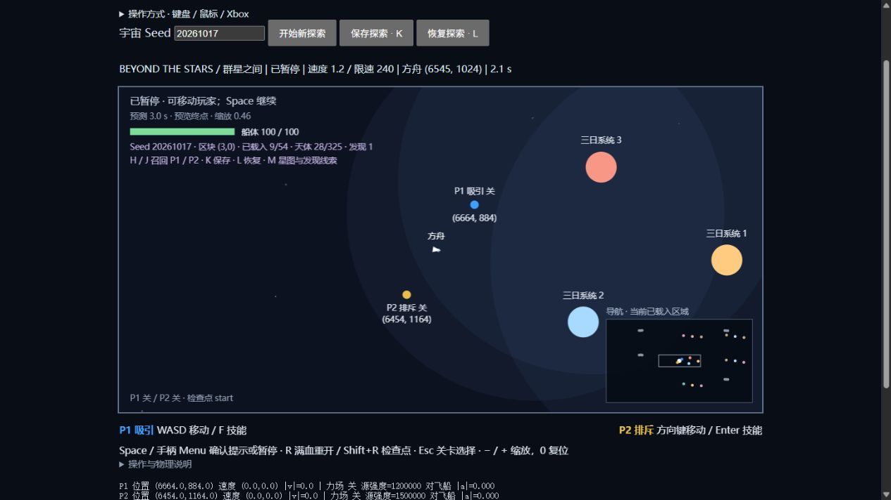
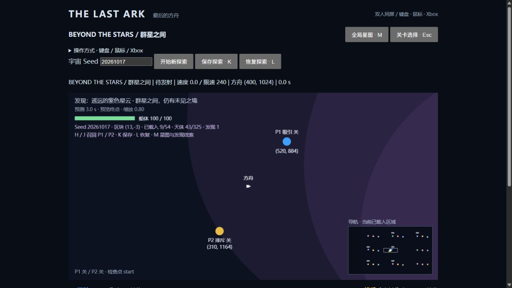

## 天体碰撞修复（2026-10-17，上轮记录；目标现已统一为虫洞）

原问题不是半径画错：旧版只检测飞船危险事件和黑洞捕获，普通天体之间没有接触求解。现已分离检测、求解与事件，并用相对运动 Swept Circle、防穿透位置修正和曲率子步接入原固定步引力积分。玩家输入、能力和镜头不变，节点不参加实体碰撞。

- 小行星相撞：按质量和恢复系数反弹，默认0.45，深度重叠会分离。
- 小行星撞行星/恒星：吸收并移除，不随意踢动巨体。
- 行星/恒星相撞：默认摧毁较小者，可配置合并或任务失败；轨道脚本不会同时收到弹球冲量。
- 飞船撞危险天体：首次接触失败；事件视界吸收，不反弹；虫洞继续作为转场触发器。
- 空间站：满足任务速度才允许进入；超速在外缘碰撞退开，默认恢复系数0.35，可再次尝试。飞船不会被直接清零速度。
- 屏幕外已加载天体同样参与接触；碰撞检测复用空间哈希。销毁后直接退出当前物理和渲染实体列表。

配置、公式、性能预算和极端情况详见 [COLLISIONS.md](docs/COLLISIONS.md)。本次没有制作新美术、剧情或修改玩家能力。

**361项测试 / 20文件及生产构建通过**。新增30项碰撞测试，包含用户要求的12类情况，并验证同一步二次碰撞、同心/深度重叠、30秒连续接触能量、曲线扫掠、轨道合并、暂停/重试/预测和镜头无关性。原试玩30条、合作6条、第二教学9条及完整序章、太阳系、黑洞、无限探索路径仍通过。入港脚本改为提前部署金场、观察预测后制动；无限探索路线绕开会相互反弹的碎石群。

浏览器实测：±100小行星碰后∓45分离；240船速单帧穿越微小障碍时在首次接触点失败；240撞站以反向84退开；30速度于1.33秒正常入港；Space暂停和R复位正常，未记录控制台警告/错误。测试入口为 `?dev=1&scene=coop_test&section=collision-bounce`，也可选 `collision-ccd`、`collision-dock`、`collision-dock-slow`。

仍未实现旋转/摩擦/碎片和精确长期接触岛求解。极密堆积采用有界迭代及保守停留，极端曲率受16子步上限限制；单步多次反弹穿越多个传送器的转场先后尚未细分。真实双人长时间手感仍需人工试玩。

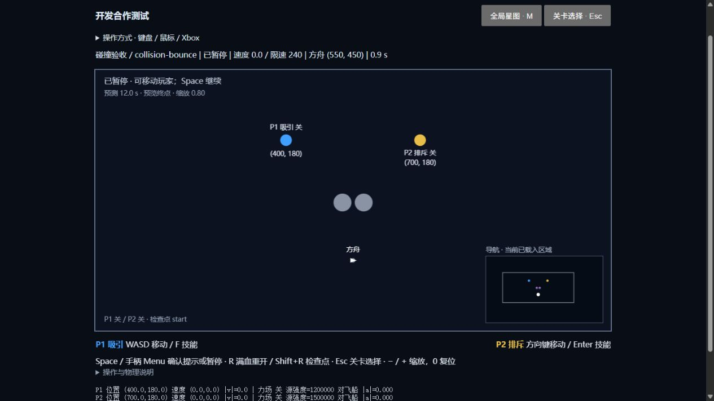
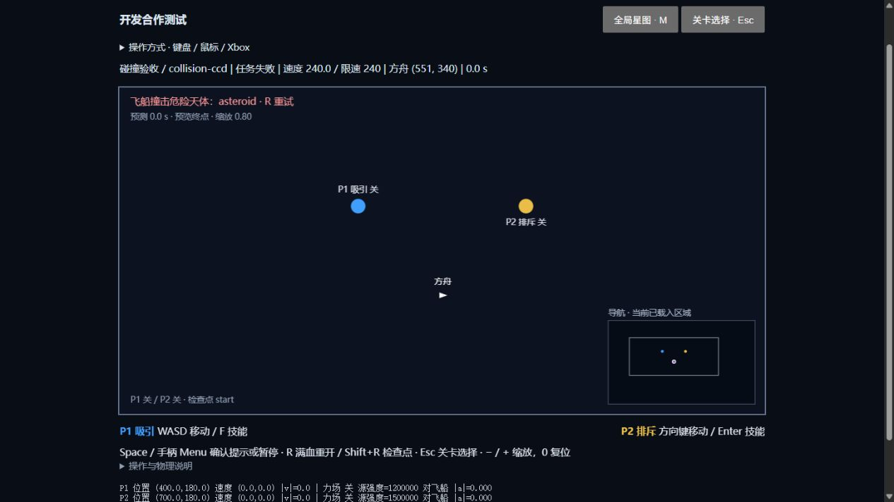
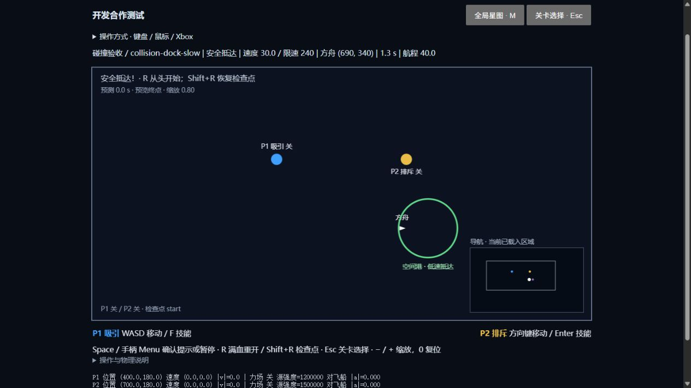

## 目标统一为虫洞（2026-10-17，最新规则）

空间站实体碰撞已删除，所有现有关卡目标改为 `wormhole`。虫洞只有范围/任务触发，不反弹、不吸收天体，不自动改变飞船速度。原有限速保持：例如 The Moving World 仍需≤48且完整进入；超速提示 `TOO FAST TO TRANSFER`，飞船可以直接穿过，减速返回后再试。First Contact 的虫洞仍不限速。

教学、章节描述、地图标签及预测完成提示改为“虫洞 / 跃迁”。数据结构中保留旧 `station` 类型和少数旧 ID，仅供历史配置兼容，接触系统同样跳过它们；没有新增空间站玩法。天体之间的反弹、吸收、黑洞视界和高速障碍 CCD 不变。

本轮 **364项测试 / 20文件及构建通过**，新增旧类型兼容、所有关卡目标类型、各种天体自由穿越检查。浏览器实测240船速穿过虫洞后仍为240（x=848，已超过虫洞右缘818），30船速正常于1.33秒完成，未记录警告/错误。最新开发入口为 `?dev=1&scene=coop_test&section=collision-transfer` 或 `collision-transfer-slow`。上节的超速撞站行为与截图属于上一轮历史记录，已被本规则替代。

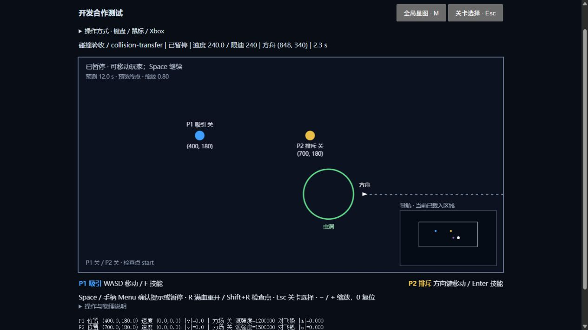
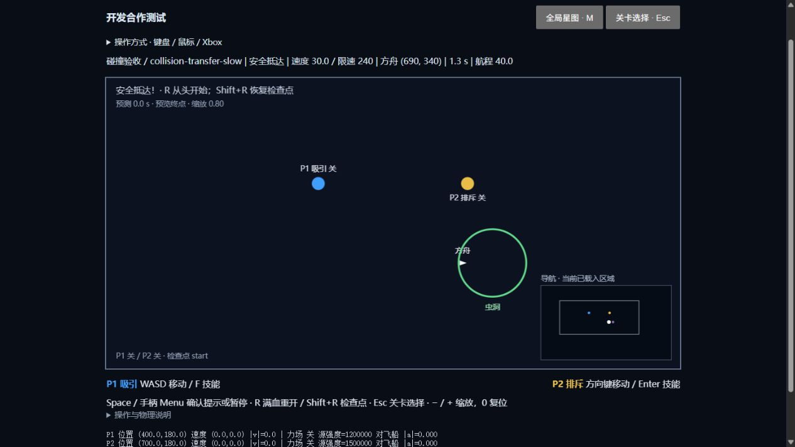
