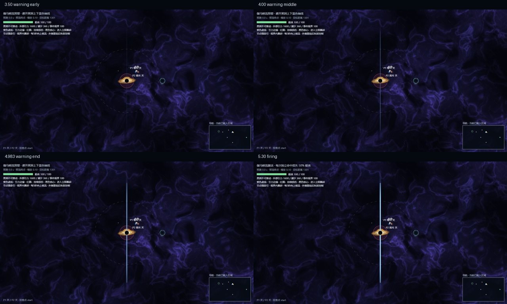

# 黑洞关视觉与喷流验收

2026-10-22 更新：原先蓝色胶囊的圆头已由连续可变宽度尾流替换。最新参数、逐层根因、前后截图与 580 项回归结果见 [喷流尾端返工记录](../jet-tail-repair/README.md)；下文保留较早版本的验收记录。

本次覆盖星云去重复、背景引力透镜、喷流空间渐隐，以及追加的 Warning 分段光柱修复。保持 Canvas 2D。以下截图来自真实浏览器中的游戏渲染器；专项验收页使用开发快照，普通路线验证另列。

## 最新修复：连续的蓄力光束

根因是正式喷流在 Warning 阶段设置了 `setLineDash([14 / zoom, 12 / zoom])`，配合圆头 stroke，形成分离的发光胶囊。现已删除该虚线分支，在 `src/render/hazards.ts` 绘制每侧光束前显式清空 dash。

- 三个阶段使用同一套连续几何：蓝色可读核心、逐渐收尖的白色内芯、蓝紫羽流、细流与粒子。
- `src/game/hazard-geometry.ts` 的 `jetVisualEnvelope()` 控制时间变化。Warning 亮度由 0 平滑增至 0.56，宽度由 0.22 增至 1；Firing 在 0.56 与 1 之间平滑增减，保持完整碰撞宽度；Dissipating 从相同亮度、宽度和颜色继续衰减。
- Warning→Firing 和 Firing→Dissipating 两侧的亮度、宽度、热度及粒子密度数值完全相接。使用 smoothstep，无逐帧随机明灭。
- 粒子使用连续的游戏时间，不在切换阶段重置。根部平滑出现、远端平滑消失；进入无伤害尾部时，额外亮度衰减也使用连续插值。
- HUD 继续明确显示“伽马喷流预警”或“伽马喷流激活”。预警光束可见不代表产生伤害。

四张同镜头截图（zoom=0.10，t 为游戏秒数）：

| 阶段 | 时间 | 截图 |
|---|---:|---|
| Warning 初期 | 3.500 | [warning-0.png](warning-0.png) |
| Warning 中期 | 4.000 | [warning-1.png](warning-1.png) |
| Warning 末期 | 4.983333 | [warning-2.png](warning-2.png) |
| Firing | 5.300 | [warning-3.png](warning-3.png) |

另有 [近景蓄力](warning-near.jpg)、[12 帧完整周期](jet-continuous-frames.png)、[正常游戏 Warning Collider](game-warning-collider.jpg) 和 [Firing Collider](jet-collider.jpg)。四张单图从浏览器画廊截图裁出；组合图仅增加时间标签，不改游戏像素。

## 空间渐隐与伤害边界

真实危险长度保持每侧 2400 世界单位，半宽 24，起点为黑洞极区 `(1300, ±100)`，轴向仍为世界 ±Y。周期 5 秒、Warning 2 秒、Firing 0.8 秒、Dissipating 0.75 秒保持原配置。此次增加的 960 单位尾流仅为视觉，完整可见长度为 3360。

`jetSpatialFade()` 在完整可见长度的 45% 处开始 smoothstep 衰减，到远端归零。主核心、中层、羽流与细流的轴向渐变和粒子都调用这一函数。每层最终透明度同时乘以时间包络和空间包络。

白色内芯在危险核心后半段收尖；蓝色可读胶囊仍覆盖权威碰撞体，在危险终点（包括圆头）空间强度大于 0.5，随后接弱蓝紫无伤害尾流，避免不可见末端仍致伤。没有通过更改碰撞长度来掩盖视觉问题。

碰撞继续只读取同一 `JetGeometry`：Warning / Dissipating 无伤害；Firing 独立有效命中扣最大生命 50%，持续接触不重复扣血；第二次有效命中死亡。事件视界、节点捕获及喷出时钟未修改。

## 背景与透镜

原背景重复来自约 2400 单位纹理平铺；局部不透明形变覆盖还可能暴露矩形边界。黑洞关现使用独立 `abyss-material.ts` / `abyss-background.ts` / `abyss-worker.ts`：世界坐标多尺度噪声、domain warp、连续区块采样，基础区块 1024、纹理 192×192、一像素 gutter。Worker 只处理当前可见请求，LRU 最多 48 块；不逐帧生成像素。原通用背景模块没有实质修改。

`lensing.ts` 提供有限、单调、边缘连续的二维径向光线映射。星点正投影和星云逆采样使用同一个模型；逆采样在 Worker 缓存生成时求解。影响半径 900，中心取黑洞真实世界位置。远处恢复原背景，少数亮星增加弱切向弧。真实实体、碰撞及轨迹预测不参与光学变形。

只在 `beyond-the-horizon` 启用该背景。`low` 禁用透镜与节点背景网格，`off` 返回原有低成本背景路径；high / medium 的节点形变网格分别为每块 12 / 8 格。透镜只对与有限影响范围相交的可见区块求解。

证据：[普通视野](phase1-normal.jpg)、[大范围视野](phase1-wide.jpg)、[关闭透镜](lens-off.jpg)、[开启透镜](lens-on.jpg)、[中心与网格](lens-debug.jpg)、[相机平移录像](camera-pan.webm)。录像已重新前台录制并保存约 1.9 MB；最后一次回放检查因浏览器工具审批超时未完成，因此不将该文件单独作为流畅度证明。实际平移画面和回到中心的状态已在录制时查看。

P1 用于中心遮挡、金白盘面和弯折结构的关系参考。本次保持已有吸积盘，新增背景光线偏折；背景仍采用游戏原有紫色深空语言。属于二维视觉近似，不声称复刻 P1 或进行真实广义相对论光追。未引入外部贴图。

## 复现与调试

运行 `npm run dev -- --port 5174`：

- 正常游戏：`/?dev=1&scene=black_hole`，载入“喷流预警 / 喷流激活 / 喷流消散”，打开 Debug Collider。
- DEV 美术面板可独立开关星云、星点、透镜、吸积盘、喷流、背景节点形变；可显示中心、事件视界、吸积盘外缘和透镜网格。
- 锁定开发相机后，可选择近景、完整喷流、大范围背景或左右平移。Debug 吸积盘半径直接读取 `ACCRETION.outer`，避免手写半径偏差。
- 专项页：`/tools/black-hole-vfx-review.html`，可设时间、播放周期、生成四帧 / 十二帧、录制暂停时间下的相机平移。

## 验证结果与边界

- 全量测试：43 个文件、574 项通过；包含时钟同步、50% 命中、连续接触、暂停/重试/检查点、危险端点与无伤害尾部、无虚线、透镜逆映射与区块连续性。
- 最终定向回归：透镜、危险绘制契约、喷流包络 24 项通过。构建 `npm run build` 通过。
- 浏览器：已查看近景与全喷流缩放、四个蓄力/喷射时刻、完整消散序列、透镜 A/B、Collider、相机平移。正常游戏 Warning 叠层明确为 `damage=false`。
- 黑洞正常起点经现有普通输入自动护航完成：48.700 秒，HP 100，航程 3449.4，末速 49.63。记录：[路线结果](game-route-result.txt)、[完成画面](game-route-complete.jpg)。这是普通输入自动回归，不等同于真人双人游玩体验验收。
- [教学关](regression-tutorial.jpg)、[太阳系](regression-solar.jpg)、[无尽模式](regression-endless.jpg) 均实际打开查看，未见新增控制台 warning/error；这些场景检查不声称完成全流程通关。
- 当前浏览器专项渲染近景 p50 约 0.9 ms / p95 1.1–1.3 ms；宽视野约 2.4 / 2.9 ms。正常游戏暂停快照（包含预测）观察约 1.0 / 7.6 ms。这是本机当前样本，不是跨设备保证或修改前后同条件性能对比；后台节流时 rAF 可大幅降低。
- 背景缓存首次进入新视野需要 Worker 生成；截图和稳态性能采样在缓存完成后进行。未做所有设备、所有缩放下逐像素无缝证明。

## 本地提交

1. `0223f49` — Replace repeating abyss nebula with cached world-space clouds
2. `f2966af` — Lens abyss nebula and stars through one world-space light map
3. `b122247` — Make gamma charge beams continuous with shared spatial and temporal fades
4. 最终验收提交 — 文档、场景回归证据、Debug 半径对齐及粒子尾流连续过渡。

保留本地配乐分支的交付约定，本轮不上传含配乐的分支。
