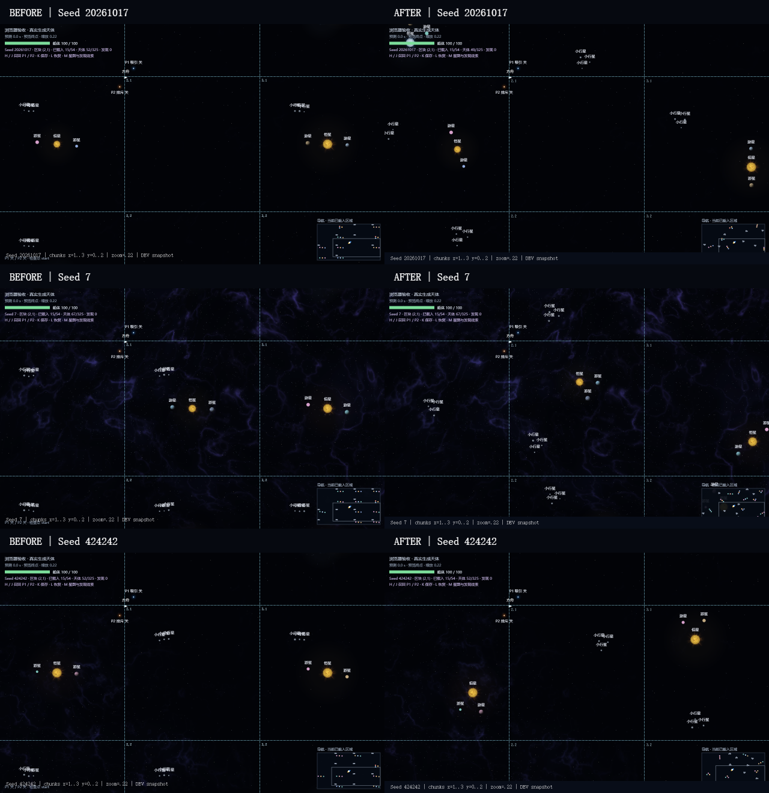

# 无限模式布局更新 · 2026-10-23

本轮仅改变既有内容的位置、整体方向和初始运动配置。保留单恒星及两颗行星、三个小行星组成的小群、原有三恒星彩蛋与星云；不新增天体种类、星域类型、结构或玩法。生成概率、物理参数、节点操作、引力规律、碰撞及加载预算保持。

## 已确认的固定来源与修改

| 原先的固定来源 | v2 处理 |
|---|---|
| 每个系统都在 `(1024,1024)` | Seed 子流采样中心，合法范围包含整个系统占地 |
| 两行星几乎沿水平线、永远距恒星300 | 整体方向覆盖 `0～2π`，系统尺度270～320；相位选择60°/180°/300° |
| 小行星在 `(530+i×70,510+微小抖动)` 排队 | Seed 决定群中心、旋转、各成员的二维位置，保留三颗与原半径 |
| 星云装饰集中在中部固定范围 | 移动、旋转原有三片云的位置，不改颜色、半径及背景材质算法 |
| 保证出现的三日系统只在东侧，星云 y=-3 | 近处三日系统、远方星云按 Seed 选择全周方向，保留原大致距离层级 |
| 所有物理天体保留440边距 | 按完整碰撞圆保留80净边距；系统中心还包含整个行星/三恒星占地 |

`generateChunk()` 保留旧内容随机数的消耗顺序。位置、系统朝向、群位置和装饰分别使用用途标签派生的子流，调整装饰不会改动物理参数。原有0.68普通系统、0.55小行星群、0.018额外三日系统、0.12普通云片规则没有改动；保证存在的彩蛋迁移后，其原/新区块内容会相应不同，因此同一有限区域内的统计总数不要求逐项相等。

### 运行稳定性的限制

试验发现：直接独立抖动两颗共轨行星的半径和相位，会在原有有限范围引力下相互追近并产生异常逃逸。没有通过改质量、场强、节点响应、固定轨道或回位来掩盖。

最终保留两个经过验证的初态关系：对置或 ±60°，再随机整体转角和共同尺度。依据已有 `bodyGravity()` / `fieldAcceleration()` 计算共同旋转中心，调用 `seedCircularVelocity()` 为所有成员确定初速度；±60° 情况也包含恒星的小幅反向运动。后续完全由真实积分器推进，不保存或执行轨道脚本。

**剩余模板痕迹：**每个普通系统仍是两颗行星，初始两者共享系统尺度，相位关系仍是受限组合；三恒星仍保持原有正三角内部结构，小行星仍是三颗的小群。没有实现任意独立半径/相位或复杂跨区块星系，也不声称长期天文轨道稳定。

## 安全与预算

- 所有初始物理碰撞圆到所在区块边界净距至少80。相邻区块两圆在分隔方向的净距至少160；角落接缝同样安全，不依赖加载顺序或查询邻居。
- 系统中心按最大 `距离中心 + 天体半径` 采样，包含行星占地；不能只让恒星中心不越界。
- 小行星群的二维采样保证成员之间的净间距；再检查与恒星/行星的间隔，并保持在原系统有限引力覆盖外围，避免刚生成就落入核心。
- 群位置拒绝采样最多48次，失败选择确定性的合法远角；没有递归生成邻区块。5184样本中回退0次，最多尝试20次。
- 起点保留安全准备区域。保持每区块最多6个物理天体、加载最多54块、缓存32块、最多325个实体、发现64条及200万字符存档上限。
- 物理加载继续只读方舟和两个节点的位置；相机不会生成天体。原点重定位、被推离区块天体的保留、重载危险体无害等待机制均保留。

## 确定性与旧存档

存档容器版本仍为1，新加独立 `universe.generatorVersion`：

| 世界 | 生成规则与兼容 |
|---|---|
| 没有生成器标记的旧存档 | 识别为v1，保留保存的实际位置、速度、缓存与玩家扰动；后续新区块和淘汰后重建仍使用v1 |
| 新建宇宙 | 使用v2；相同Seed、区块坐标和版本始终重现相同初始布局 |
| R 从起点重开 / 检查点重试 | 保留当前世界的生成器版本 |
| “开始新探索”按钮 | 建立v2世界；不会自动删除或覆盖旧存档，仍需用户明确保存 |

生成、发现距离、M星图线索、开发跳转与特殊星云背景读取同一份版本化坐标。背景只调整已有星云的锚点；缓存与Worker任务包含版本，切换同Seed的旧/新世界时清理缓存，并忽略旧Worker的迟到回包，仍保持原缓存上限。

默认Seed `20261017` 的v2三日系统为区块 `(2,3)`，中心约 `(5481.12,6806.45)`；星云为 `(14,3)`，中心约 `(30301.98,7165.32)`。v1保留原 `(3,0)` / `(13,-3)`。其他Seed以M星图为准。

浏览器对修改前实际保存的 [v1测试存档](before-save-v1.json) 做了恢复检查：天体、速度、缓存保持一致，恢复操作没有写回存储。该文件来自独立测试场景，不是用户存档。

## 多Seed量化检查

固定64个Seed，每个取 `x,y=-4..4` 的81个区块，共5184个初始区块。完整坐标与统计见 [原始分布](layout-distribution.json)。以下位置都是区块局部坐标。

| 指标 | v1 | v2 |
|---|---:|---:|
| 普通系统中心 X 范围 | 1024 | 394.47～1665.33 |
| 普通系统中心 Y 范围 | 1024 | 390.62～1658.75 |
| 占据的九宫格区域 | 1 / 9 | 9 / 9 |
| 首颗行星朝向占据的45°角度段 | 1 / 8 | 8 / 8 |
| 小行星群中心占据的象限 | 1 / 4 | 4 / 4 |
| 三日彩蛋方位角度段 | 1 / 8 | 8 / 8 |
| 恒星至行星初始距离 | 300 | 270.02～320.00 |
| 样本最小天体净间隔 | 32.12 | 78.46 |
| 样本最小区块净边距 | 491.10 | 81.52 |

v2八个朝向段计数：`413,433,436,405,423,434,434,432`。小行星四象限：`656,688,711,661`。九区域均有样本，位置变化超过1000单位；不是只在中心抖动十几像素。

## 真实浏览器对照

Edge 155、1280×800、DPR 1。三个Seed均用相同相机 `(5120,3072)`、缩放 `.22`，查看连续相邻区块 `x=1..3,y=0..2`，分别保留边界叠层和正常画面。叠层为截图上按真实世界坐标投影的开发边界标注；没有移动、增补或改画天体。

| Seed | 修改前 | 修改后 | 关闭叠层后的画面 |
|---|---|---|---|
| 20261017 | [边界图](before-20261017-grid.png) | [边界图](after-20261017-grid.png) | [正常画面](after-20261017.png) |
| 7 | [边界图](before-7-grid.png) | [边界图](after-7-grid.png) | [正常画面](after-7.png) |
| 424242 | [边界图](before-424242-grid.png) | [边界图](after-424242-grid.png) | [正常画面](after-424242.png) |

原来的恒星中心横排、水平对置行星与角落碎石横线已消失。新版依然能识别单恒星系统、三颗小行星的小群及空旷区域；并未增加内容来填满画面。

### 连续飞行与动态观察

独立测试浏览器中，从真实起点以初始船速 `(240,0)` 开始，之后仅运行 `stepGame(NO_CONTROLS)` 的固定时间步；没有中途传送、修改船速、关闭引力或移除危险体。相机正常跟随飞船，关闭边界叠层。

- 实际墙钟约40.30秒，模拟40.017秒；连续经过 `(0,0)` 到 `(4,0)` 五个区块，实际移动约9604单位。
- 原点从 `(0,0)` 移至 `(4,0)`；每步绝对坐标位移最大4.000000000002，符合240速度上限，没有重定位跳跃。
- 最多加载23块、79个天体、4块缓存；HP始终100，未加载到飞船身上或中途失败。
- 连续帧已查看：[飞行采样图](continuous-flight.png)、[约40秒浏览器录像](continuous-flight.webm)。
- 此场景独立 `render()` CPU调用 p50/p95 约0.3/0.4ms，不含游戏整帧的物理、预测和UI成本，不作为跨设备FPS保证。

这段是实际时间推进的自动连续飞行；多Seed全景使用开发跳转，两者分别记录。没有将跳转称为实际航行，也未声称完成v2两处彩蛋的完整人工驾驶。旧版已验证的长路线仍作为v1存档回归。

## 测试、复现与交付

- 本地 `npm run check`：44个文件、592项测试通过，严格TypeScript检查与生产构建通过。
- 无音乐发布工作树独立执行 `npm run check`：43个文件、585项测试通过，生产构建通过，输出中没有MP3/FLAC/WAV等音乐资产。两套计数的差异来自只留在本地的音乐接入测试，本轮布局、碰撞、存档及主线测试相同。
- 新增布局测试：内容数量/概率抽样及物理参数不变、5184区块分布、所有边/角邻接、混合版本接缝、加载顺序与大坐标确定性、起点安全、发现/调试/导航一致、v1/v2保存恢复、未知版本拒绝、三Seed连续飞行和重定位。
- 6个Seed下，普通系统、三恒星和含小行星区块分别运行120秒真实固定步/CCD，共18组；无NaN/Infinity、初始碰撞、合并丢失或异常逃逸。普通系统行星距恒星相对变化在2%以内。
- 保留原1000邻域加载/缓存/存档压力测试、旧世界30区块航行和输入路线、引力/节点施力、暂停、重试及主线回归。旧“必须留440边距”和“必须距(1024,1024)为300”断言替换为实际安全与运行约束；没有删掉真实碰撞/伤害断言。
- 背景版本切换另有迟到Worker结果及完整重置回归，避免旧世界纹理污染同Seed的新世界。
- 最新浏览器记录见 [修改前](before-report.json)、[修改后](after-report.json)，未捕获JS异常。未做跨设备、长时间人工探索或任意外力下永久稳定性验收。

启动 `npm run dev -- --port 5182 --strictPort`，可用 `/?dev=1&scene=endless&seed=7` 进入新世界；彩蛋跳转使用 `section=triple` / `section=nebula`。旧C/E/性能脚本的硬编码彩蛋地址已改读生成器同一坐标；本轮完整视觉验收使用 `tools/endless-layout-qa.mjs`，没有把早期阶段历史报告冒充本轮复测。

专用无头浏览器启动方式见 `tools/endless-qa/README.md`，本轮使用 `ARK_CDP_PORT=9343`、`ARK_URL=http://127.0.0.1:5182/?dev=1&scene=endless&fx=high`。修改前运行 `node tools/endless-layout-qa.mjs before`，修改后运行 `node tools/endless-layout-qa.mjs after`；基线拒绝覆盖，after包含约40秒实际时间的飞行采集。

提交到独立分支 `codex/endless-layout-v2`，从远端 `codex/gravity-visual-demo` 的 `5adccc8` 干净历史构建。先移植已有黑洞视觉依赖，再分开提交喷流尾端和本轮布局。排除音乐文件、音频接入改动及本地 `f7463b6` 音乐提交历史，不合并main；发布工作树已独立通过完整测试和无音乐构建。
