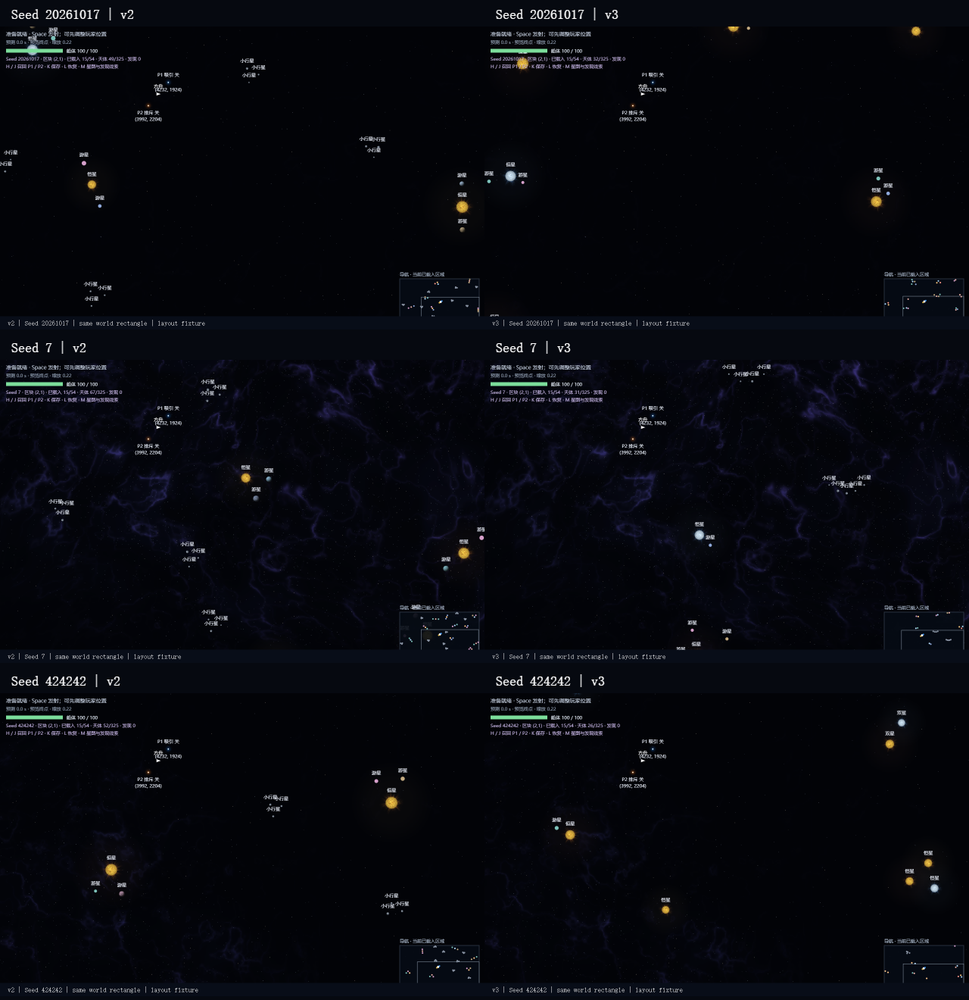
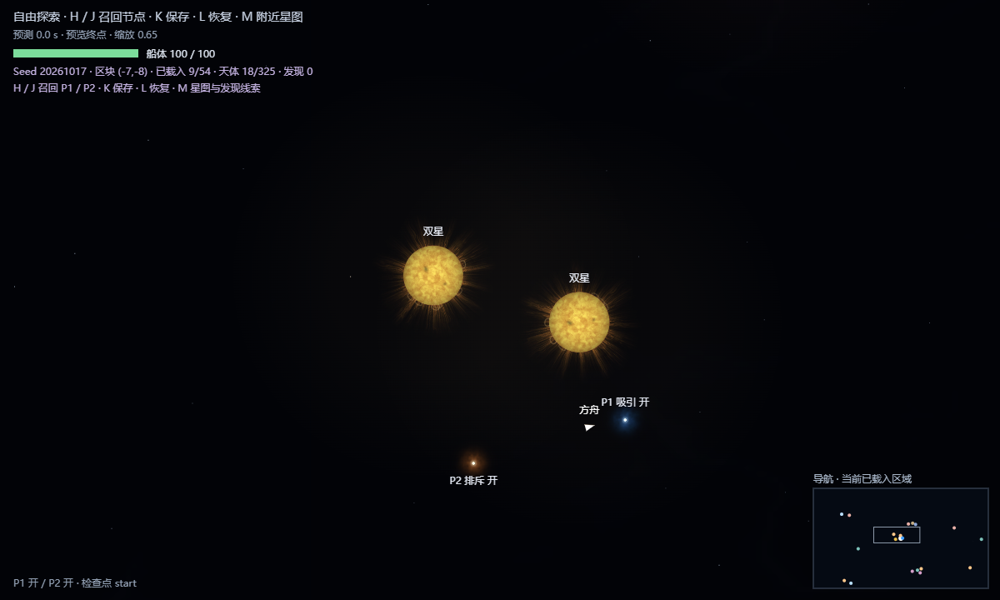
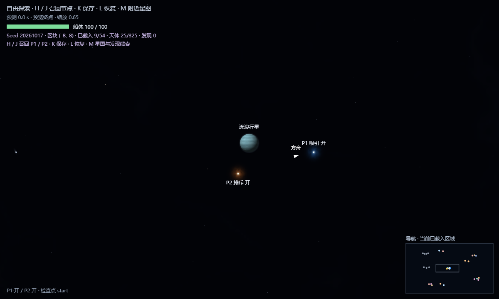
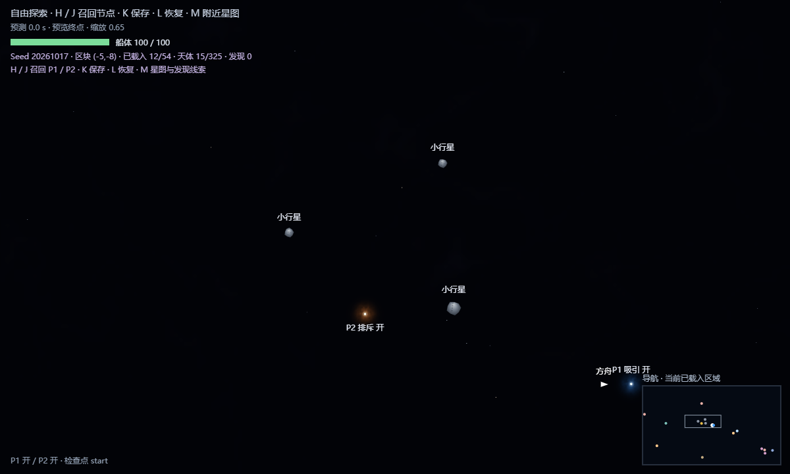

# 第一阶段验证记录 · 2026-10-24

基线：43 文件 / 585 项。最终完整检查：45 文件 / **602 项通过**，类型检查、生产构建通过。Node 24.20.0、TypeScript 5.9.3、Vitest 5.0.4、Vite 8.3.4。没有修改主线物理、输入或镜头模块；旧 v1/v2 断言保留在明确版本的 fixture 上。

## 组合与稳定性

[8,192 块分布](distribution.json)包含所有启用家族和 1/2/3/4 行星、2～5 碎石；正负/高位坐标、乱序、起点与四边/对角间距均有测试。没有通过每隔 N 块强放指定家族满足统计。

[33 组稳定性原始记录](stability.json)：代表家族 120 秒，双星与多行星 600 秒。碰撞事件、碰撞预算耗尽、非有限数值均为零；v3 最高速度 71.31，未长期触及 240 限速。v2 行星半径比值 1.000000～1.000175，v3 为 0.996852～1.003565，最终回归阈值为 ±2%。没有由此推断无限期稳定或任意邻星/玩家扰动后仍稳定。

## 浏览器性能

同一台 Intel(R) Core(TM) Ultra 7 265K、Windows 10.0.26200、Edge 155.0.4283.62；视口 1280×800，游戏 Canvas 1140×520，DPR 1，medium 质量。每个短样本从正常起点用同一测试控制器连续运行约 30 秒，含原固定步、预测、UI 与渲染。v2/v3 的实体数量本就不同，因此比较的是实际模式成本，不是相同实体数的渲染微基准。

下表为主线程帧工作耗时（毫秒），不是单纯绘制时间；RAF 间隔与所有帧原始数组另保存在 perf-v*.json。独立 headless 浏览器可运行高于 60 Hz，不能直接把其平均频率当普通显示器体验。

| Seed | 版本 | p50 | p95 | p99 | 最大 | 实体/加载块/热快照峰值 |
|---|---|---:|---:|---:|---:|---|
| 20261017 | v2 | 0.60 | 16.20 | 21.50 | 60.90 | 55/15/11 |
| 20261017 | v3 | 0.60 | 2.50 | 17.10 | 28.50 | 36/15/8 |
| 7 | v2 | 0.70 | 1.70 | 26.60 | 34.30 | 61/15/11 |
| 7 | v3 | 0.60 | 1.40 | 11.20 | 19.50 | 28/15/11 |
| 424242 | v2 | 0.60 | 15.40 | 22.00 | 28.40 | 46/15/11 |
| 424242 | v3 | 0.60 | 1.20 | 10.80 | 20.90 | 24/15/11 |

三组均无页面异常。60 FPS 是目标；偶发帧峰值仍超过 16.67 ms，不能宣称全程稳定 60 FPS。性能数据不等于浏览器堆内存分析。

## 连续航行

[未剪接录屏](flight-v3-20261017.webm)、[时间接触表](flight-v3-20261017.png)、[逐帧原始记录](flight-v3-20261017.json)。Seed 20261017，从正常 (0,0)、初速 90 出发，游戏内 189.80 秒，录制及收尾 191.54 秒；到 x=24576.50，横向完整跨越 12 块，沿边界小幅转向共查询 19 个不同坐标。HP 100，加载峰值 15、实体 46、热快照 32。原始 phase=paused 是旧版录制器在结束时主动暂停，运行样本均为 running。最终发现修复只改变发现元数据，不改变此路线的初态或受力。

使用 tools/endless-v3-controller.ts，通过现有目标输入驱动两个节点；没有更改飞船位置、速度或引力。离散仿真另对 Seed 7、424242、20261017 各走完整 12 块，检查每固定步位移≤4、速度变化不超原加速度上限、无非预期暂停、重定位与血量。浏览器记录中的 maxJump 是两个 RAF 之间的距离，慢帧可包含多个固定步，不是单步瞬移。长录像的 loads 数组不是 I/O 延迟依据；使用下方原生事务计时。

## 持久化与实际交互

[浏览器检查](browser-checks.json)、[鼠标/星图/重试](input-checks.json)、[原生回访和交互案例](interaction-cases.json)。真实 IndexedDB 访问 420 条冷记录，热缓存曾满 32 后，确实卸载的移动行星从新位置恢复，速度及稳定化状态一致；删除成员没有重生。该 fixture 直接选择测试地点，单独标注，未冒充连续航线。

46 次原生读 / 46 次写，最终记录的 read p50/p95/p99=0.60/2.60/6.10 ms，write=3.90/7.20/18.10 ms。约 352498 字节编码记录；这些是当前负载的测量，不是填满 64 MiB 或浏览器最低配额的保证。原生事务 abort、缩小预算拒绝、恢复代次与旧写入租期失效均已验证。自动测试另覆盖损坏、保存中断、晚到回复、10 秒超时、世界切换和三焦点预算。

三条独立交互 fixture 的精确初态与节点控制在 tools/endless-v3-cases.mjs 和 case-*.json：

- 双星：Seed 20261017、区块 (-7,-8)，从系统左下外围接近，两场启用，约 4 秒仍安全；其中一星相对关闭技能对照偏移约 0.0069。它仍是微弱节点耦合，没有夸大成快速搬动恒星。
- 流浪行星：同 Seed、区块 (-8,-8)，从左下接近并转向；行星偏移约 0.708，船的速度方向也不同于关闭技能对照。
- 碎石：同 Seed、区块 (-5,-8)，金场部署在碎石下侧，把成员推离下方航道，蓝场带船从外围通过；两个碎石偏移约 54.46/9.41，船未碰撞。允许外围绕过，没有检测两人必须按键的隐藏条件。

双键盘同时移动和 F/Enter、Space、H/J、K/L、R、Shift+R、M，以及实际鼠标追踪、左键技能和右键制动通过。手柄设备入口在未接设备时正常提示，适配器自动测试通过；**没有真人合作或实体手柄验收**。截图是明确的开发初态/真实积分结果，不等同于玩家通关。

## 仍待完善

真人两人体验、长留白节奏、实体手柄、其他机器性能、偶发帧峰值，以及普通玩家的导出/清理界面。磁盘策略和普通恢复路径见 [范围说明](README.md)。大星域、跨块碎石河、异常天体、遗迹和虫洞不在本轮。

