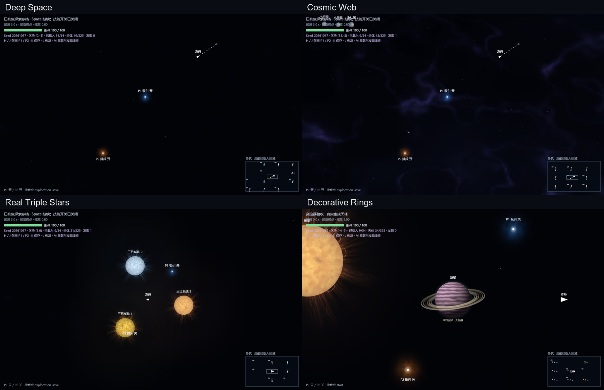

# Endless 视觉整合 · 2026-10-18

2026-10-23 布局更新：新宇宙采用版本化位置与朝向采样，保留原内容及物理。最新多 Seed 对照、运行检查和兼容策略见 [无限模式布局更新](../endless-layout/README.md)。以下为较早视觉阶段记录。

使用仓库历史提交 `19ccdc9` 中的 `space-vfx-2d` Skill；冲突处以本次用户 prompt 为准。P1–P5 参考文件在本地可访问，不发布参考原图。

## Phase A · 现有视觉接入

无尽场景接入主线的电影化节点、真实场星空扭曲及天体材料。普通背景先采用稀疏预设，后续 Phase B 替换有限重复材质。跨世界原点重定位时同步节点历史、扰动事件、天体视觉记录；背景、明暗材质与采样格使用稳定全局坐标。OFF 保持原渲染且跳过高级视觉更新。

生成器核实：已有普通恒星/两颗游星/小行星，以及真实相互引力驱动的三恒星；没有双恒星、黑洞或中子星生成分支。本次不改变生成、运动、碰撞或任务规则，不用假天体填充验收图。

## Phase B · 连续宇宙背景

世界坐标 fBm / domain warp / 多尺度脊线与尘埃生成 P2 深空和 P5 丝状密集区；颜色、密度以连续场过渡。固定子格星点在缩放 LOD 下保留同一位置；远方星系使用柔和核与盘面。局部 emissive 纹理以低频连续幅度变化，不移动整张背景。复用了节点对背景的共同位移/明暗采样。

Worker 预取相邻一圈，32 tile LRU、最多28排队+1进行中；纹理带相邻采样 gutter。LOD切换保留可见旧纹理，切 OFF 取消未完成生成，换 seed 完整清理 worker 所有权。所有纹理只在渲染缓存中。

浏览器实际检查 `phase-b-deep.png`、`phase-b-nebula.png`、`phase-b-triple.png`；与 P2/P5 对照，保留暗空间和细丝，密集区仍比 P5 更克制，不复制参考图片。三场景 OFF 对初始基线均0字节差异，GameState渲染前后相同，无浏览器异常。此阶段测得的3.7–7.5ms是独立render调用的p50/p95范围，不是完整游戏FPS。

阶段全套 `npm run check`：538测试/38文件、生产构建通过（包含正在分阶段接入的恒星/行星及长期回归测试）；背景相关独立回归覆盖跨区块一致、2^46坐标、LOD共享星点、1000视图缓存预算、OFF队列取消和换seed恢复。

## Phase C · 实际动态恒星

无尽普通恒星复用主线 sun/neutron/corona 纹理基础，增加按稳定id区分的盘面细胞、日冕形态、连续慢旋转和低频日珥。琥珀、红暖、冷蓝并非仅换渐变色。所有层使用实时body.position；三个恒星没有视觉公转。照明按真实星体位置叠加环境色温、飞船和小行星受光轮廓，排除行星盘面与危险黑核，保持固定左上受光契约。恒星24项LRU，光源按画质最多3/5/8个。

浏览器以seed20261017实际生成的(3,0)三日系统运行原stepGame，保存0/20/60秒连续检查帧和真实位置/速度：`phase-c-triple-*s.png`、`phase-c.json`。三种温度均存在，三颗恒星实际移动，60秒仍running、没有50秒能量波。截图为开发验收定位后的真实生成场景，不伪称从起点手动飞到。自动测试538/38及构建通过，浏览器无异常、渲染GameState只读。双星生成不存在，因此未虚构双星验收。

## Phase D · 行星与特殊天体复用

真实生成行星按稳定id和已有半径选择岩石地形/气态条纹与风暴/冰冷大气；部分大型气态行星具有背半环→球体→前半环层次，并明确标注装饰、不扩充碰撞。LOD 48/96/160，缓存18项；保持原左上受光方向。小行星复用已有不规则岩石轮廓。

`phase-d.json`记录真实生成的4类行星id与坐标；`phase-d-{rocky,gas,ice,ring}.png`使用游戏允许的zoom2检查。最初开发定位触发正常spawnPending保护，随后把测试飞船移到安全距离并调用原streamUniverse，未修改该规则。4种盘面和星环遮挡均实际查看。

`phase-d-mainline-black-hole.png`及`phase-d-mainline-neutron.png`明确是主线复用回归，**不是无尽模式新发现**。黑洞仍使用已有共享半径流动/贴合内缘/上方弯折盘面；中子星通过原蓝节点坍缩逻辑生成。实际对照本地P1/P4：保留纯黑危险核心、蓝白细纹理；黑洞整圆危险核心比P1前景遮挡更突出，中子星日冕射线比P4更强。本次遵守只整合现有美术，不重做主线。自动测试538/38、build及浏览器均通过。

## Phase E · 探索与最终验收

收尾修复了缩放换层时旧背景被预取挤出的问题：过渡期间保留旧可见纹理，新纹理及星点/星系用350ms交叉淡入。星云增加独立的缓慢暗尘变化，与发光细丝共享固定世界坐标，两组活动周期约48秒、74秒；没有逐帧随机或整张纹理平移。OFF取消worker任务，重新开启时重建视觉历史，避免旧拖尾和事件复活。无尽电影化场景移除旧的大面积节点范围色盘，保留近场能量和真实场驱动的星点/明暗形变；恒星表面减少过于规则的椭圆斑纹。

最终 `npm run check`：**38个测试文件、540项测试全部通过，TypeScript及生产构建通过**。相对修改前`41e117d`，`src/game`、`src/physics`、`src/world`、`src/levels`均无diff。新增3个seed各60秒逐步HIGH/OFF真实GameState深比较，覆盖原点重定位；无50秒致死波、无终点。

浏览器记录见 [phase-e.json](phase-e.json)、[final.json](final.json)：

- 相同坐标和视觉时间回访、浮动原点重定位：背景逐像素完全一致。
- 相机移动100像素后的对应世界图像：通道平均误差0.000010636、最大1/255，来自采样取整。
- 三类场景OFF对修改前初始基线均0字节差异；双节点开启时，HIGH暖缓存切OFF也与冷OFF完全一致。渲染前后GameState不变。
- 固定步长运行600秒真实模拟，航行132000单位、最终全局原点x偏移64个区块，结束仍为running。峰值91个物理天体、23个已加载区块、32项物理缓存。此测试加速执行约8.4秒，**不是十分钟墙钟测试**。
- 400次浏览器视图跳跃：背景缓存最多32项、排队加进行中最多29项；计数的纹理及合成Canvas内存峰值10,682,112字节。该计数不包含整个浏览器堆、worker、GPU驱动或所有天体材料。
- 同次压力测试GC后JS堆由10,552,876至10,816,568字节，backingStorage保持27,729,812字节；这是有限压力测试的观察，不能证明无限运行永不增长。
- zoom 2 / 0.8 / 0.2 / 0.05 / 0.001均有界；1000视图单元测试、LOD切换、seed清理和OFF取消通过。所有浏览器检查无运行时异常。

### 真实主循环性能

[phase-e-performance.json](phase-e-performance.json)通过真实UI加载专用测试存档、进入**游戏Canvas全屏**后测量。Edge 155 headless、20逻辑核、1200×720、DPR1、本地开发构建、HIGH；每场景运行约9秒，统计最近240帧，包含物理、轨迹预测、UI与渲染。

| 场景 | 节点力场 | FPS | 主线程工作p50 | p95 |
| --- | --- | ---: | ---: | ---: |
| 普通深空 | 两个开启 | 55.4 | 6.70ms | 8.20ms |
| 真实三恒星 | 两个关闭 | 60.0 | 6.30ms | 7.00ms |
| 密集星云 | 两个开启 | 56.5 | 6.60ms | 8.40ms |

目标60 FPS接近但未全部锁定；不能外推为所有设备/分辨率的性能保证。三恒星关闭力场是为保留安全测试位置，不能把该行作为双节点开启的性能结果。独立render调用耗时与完整主循环FPS分开记录。生产版Canvas全屏另有14项回归，包括键盘、星图、退出恢复、横屏、DPR2、resize和BGM实例保留，见 [production-fullscreen.json](production-fullscreen.json)。

### 截图、连续帧与复跑

- [真实三恒星4秒连续帧GIF](phase-e-triple-motion.gif)：16帧、每帧对应0.25秒实际模拟，等比例缩小，无图像增强；0/20/60秒真实位置另见Phase C记录。GIF循环末尾回到起点不代表游戏内轨道跳变。
- 星云固定镜头 [0秒](phase-e-nebula-0s.png) / [12秒](phase-e-nebula-12s.png) / [24秒](phase-e-nebula-24s.png)：低幅度局部变化，纹理世界锚点不移动。
- 节点运动 [0](phase-e-nodes-0.png) / [1](phase-e-nodes-1.png) / [2](phase-e-nodes-2.png)：实际状态推进和原点转换后的近场/背景一致性。
- 最终真实主循环截图：[深空](phase-e-live-deep.png)、[三恒星](phase-e-live-triple.png)、[星云](phase-e-live-nebula.png)。
- [浏览器复跑说明与脚本](../../tools/endless-qa/README.md)：独立测试profile、真实生成场景、完整性能和压力断言，避免修改个人存档。

### 交付范围与保留差异

已完成A–E的渲染整合与验收。现有生成器支持普通和三恒星，不支持双星、黑洞、中子星生成，本次依prompt未增加生成规则或伪造轨道；黑洞/中子星仅验证主线已有美术的复用路径。P2/P5方向的暗空间和宇宙细丝已接入，密度与亮度比P5参考更克制；P1/P4差异见Phase D。行星仍遵守固定左上受光方向，恒星局部环境照明不改该契约。没有增加危险机制、强制终点或胜利条件。

分阶段提交：A `05ef1e1`、B `411dca8`、C `fdad665`、D `8d776de`；本节、最终回归和复跑工具随Phase E独立提交。分支为`codex/gravity-visual-demo`，不合并main，不包含用户参考原图或其他原有未跟踪文件。
