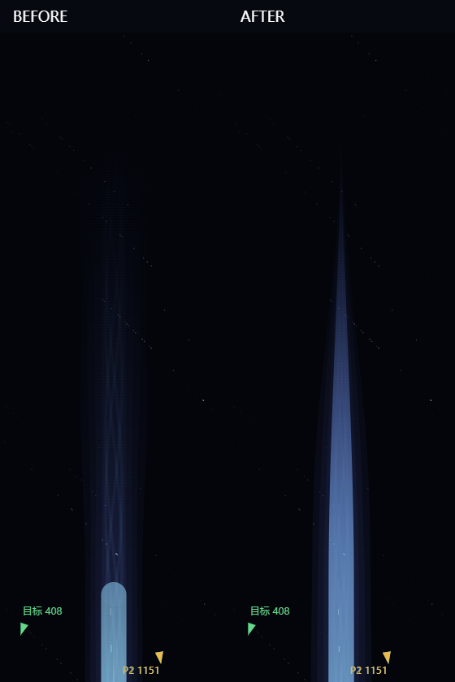
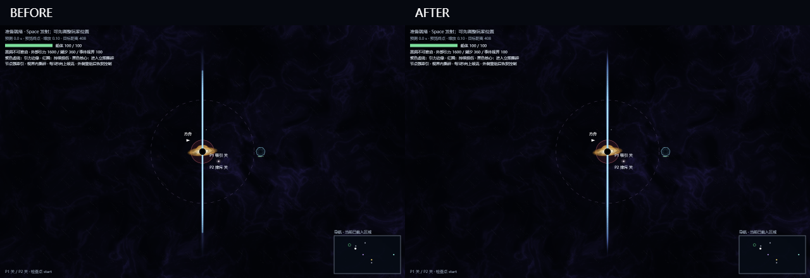
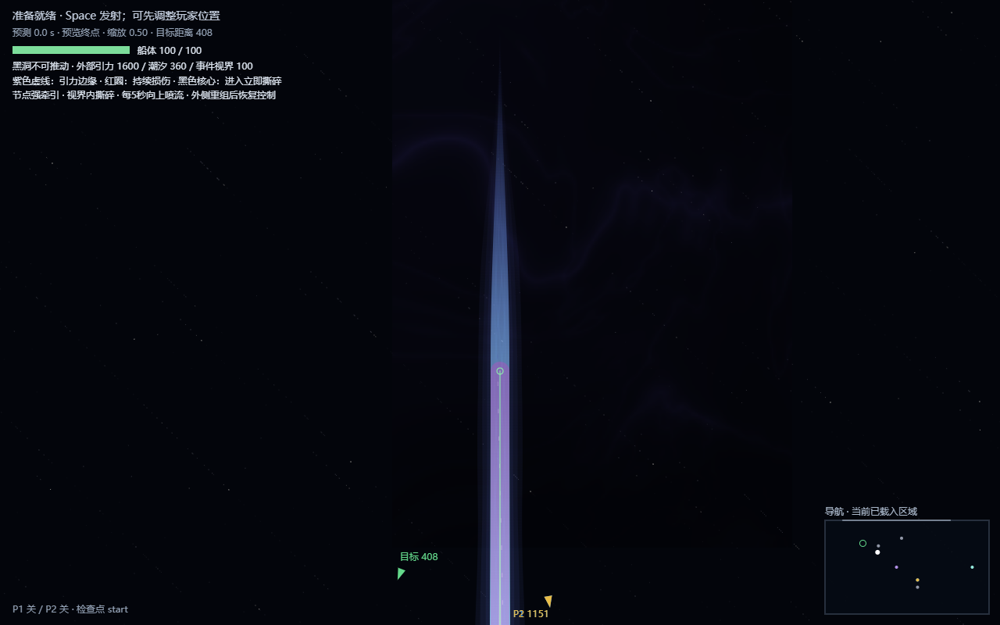

# 黑洞喷流尾端返工 · 2026-10-22

只调整两极喷流的视觉轮廓、轴向颜色和细节分布。2026-10-22 完成时按当时要求保留本地；2026-10-23 根据新版提示词，随 `codex/endless-layout-v2` 发布分支提交推送代码与文档。发布分支从远端干净历史构建，不携带本地音乐文件或音乐提交，不合并 main。

## 已定位的原因

使用真实 Edge Canvas 2D，把旧绘制逐层隔离后确认：

1. [蓝色主体单层](before-layer-core.png) 在 `jet.length` 停止，以固定 48 单位宽的圆帽 stroke 结尾，是截图中最明显的亮蓝圆头。
2. [装饰尾流单层](before-layer-tail.png) 又从这个位置开始固定宽度圆帽 stroke，在接缝处产生第二个圆头。
3. [外部羽流](before-layer-plume.png) 沿长度变宽，只有 alpha 衰减，没有几何收束；[白色内芯](before-layer-filament.png) 的局部 taper 无法改变外轮廓。

对照图由浏览器原始截图并排裁切或缩放、添加 BEFORE / AFTER 标签生成，未改绘游戏像素。

## 修改

- `src/game/hazard-geometry.ts` 新增纯视觉 `JET_TAIL_PROFILE` / `jetTailEnvelope()`。旧的 `jetGeometry()`、伤害快照、胶囊长度与半径完全保留。
- `src/render/hazards.ts` 用闭合的可变宽度 ribbon 取代蓝色主体、装饰尾流和细丝的固定宽度描边。主体与尾流现在是一个连续形状，不再通过端帽分隔。
- 白色内芯先在危险核心内部逐渐收细；蓝色轮廓保持可读，再平滑变成暗蓝紫尾流。羽流、细丝、粒子的横向散布、宽度和 alpha 都服从同一个尾段包络。
- 根部保留胶囊起始圆弧的可见覆盖。终端保护范围使用完整的 `length + coreRadius`；危险末端没有被画窄或淡到零。
- 时间包络仍由原来的 Warning / Firing / Dissipating 控制；动画只读 `game.elapsed`，没有新增动画时钟、纹理生成、框架或依赖。
- 高、中、低档和 `fx=off` 都使用同一收束轮廓；off 仅保留必要的危险束流。此次明确修正 off 的危险提示，所以喷流区域的 off 像素会变化。太阳系及黑洞非喷流视野的 off 基线逐像素比较均为零差异。

## 参数与危险边界

每束真实长度仍为 2400，半宽仍为 24，根部 `(1300, ±100)`，方向为世界 ±Y。尾流 960 为原有纯视觉配置，未扩长；总视觉长度为 3360。

| 纯视觉参数 | 值 | 用途 |
|---|---:|---|
| `taperStart` | 0.5 | 在真实长度的一半开始轻微收束 |
| `protectedWidth` | 0.88 | 到完整危险末端仍保留原始半宽；根部蓝色宽度约为原来的 1.136 倍 |
| `coreAlpha` | 0.68 | 完整危险末端的空间 alpha 下限，再乘时间 alpha（Firing 最低 0.56） |
| `widthExponent` / `fadeExponent` | 1.05 / 1.2 | 无伤害尾段 smoothstep 的宽度与透明度曲线 |
| `filamentStart` / `filamentExponent` | 0.32 / 1.1 | 白色内芯较早、平滑地收细 |
| `samples` | 80 | 各侧固定采样预算，不随粒子数或运行时间增长 |

相对根部，完整危险末端为 2424，余下 936 单位完成主要收束和淡出，避免最后几个像素突然切尖。远端宽度、alpha、粒子亮度均为零。主轴始终固定。

调试图中粉色圆帽是原有 Collider 叠层，关闭叠层后的正式画面见 [上尾端](after-upper-tip.png)、[下尾端](after-lower-tip.png)、[根部](after-root.png)。

伤害仍为：Warning 无伤害；Firing 才伤害；Dissipating 关闭伤害；独立有效暴露扣最大 HP 的 50%；持续接触不逐帧扣血；第二次命中可致死；事件视界立即失败。没有修改伤害计算、CCD、节点能力、路线、太阳波或 Endless Mode。

## 验证

- `npm run check`：43 个测试文件、580 项测试通过；TypeScript 检查与生产构建通过。
- 新增 6 项空间包络测试，覆盖单调收尖、末端归零、完整危险边界、曲线连接处连续导数、上下对称、粒子循环隐去、阶段边界组合、退化输入有限性。
- 更新原绘制契约测试，直接检查真实填充多边形覆盖胶囊的每个截面，包括首尾圆帽，不再要求使用旧的 round-cap stroke。保留所有真实伤害、50% 命中、CCD、暂停、重试及检查点断言。
- 原有渲染只读测试通过：相机平移缩放及绘制不改变游戏状态或权威几何。
- 真实 Edge 155、1280×800、DPR 1 中查看上下尾端、完整喷流、黑洞根部、Collider、相机平移/缩放，以及 high / medium / low / off。
- 浏览器实际连续播放 5 秒，覆盖模拟时间 3→8 秒，观察 Warning → Firing → Dissipating → Cooldown。没有回到圆帽或出现末端亮点；[实际连续帧](after-live.png)、[精确阶段边界对照](after-phases.png)、[5 秒浏览器录像](after-cycle.webm)。粒子与羽流运动仍使用原模拟时间。
- 另在实际黑洞验收页操作新增的上下尾端视角与低画质选择，查看 [上尾端动态采样](review-upper-live.png)、[近景浏览器录像](review-upper-cycle.webm)、[下尾端低画质](review-lower-low.png)。该页无 JS 异常，低画质近景的最近 240 帧 render p50/p95 为 0.6 / 0.9 ms（异步背景缓存已就绪）。动态采样图首格为播放前的 t=5.4 参考帧，其后按实际时间连续采集。
- 固定模拟时刻，在真实 Canvas 中相隔 200 ms 再绘制，喷流逐像素一致。该检查单独隔离喷流，以排除原有背景 Worker 首次填充缓存的变化。
- 相机检查覆盖上尾端 `(1300,-2950), zoom=.65`、平移 `(1200,-2750), zoom=.5`、下尾端 `(1400,2900), zoom=.8`、全景 `(1300,0), zoom=.1`，见 `after-pan-0.png` 至 `after-pan-3.png`。
- 未捕获到浏览器 JS 异常。

### 本机性能

同一浏览器、分辨率、固定 Firing 快照、完整喷流视角；每档预热 20 次，测量 80 次。下表为真实 CPU 调用耗时，不代表 GPU 完成时间或跨设备 FPS 保证。`hazards` 包含验收用 Canvas 代理计数开销。

| 档位 | 整体 render p50/p95，修改前 → 后 (ms) | hazards p50/p95，前 → 后 (ms) |
|---|---|---|
| off | 0.1 / 0.2 → 0.2 / 0.4 | 0.1 / 0.2 → 0.2 / 0.3 |
| medium | 2.8 / 3.9 → 3.0 / 3.5 | 0.3 / 0.4 → 0.6 / 0.8 |
| high | 2.7 / 3.0 → 3.0 / 3.5 | 0.3 / 0.5 → 0.6 / 1.0 |

高/中档喷流 fill + stroke 从 118 降为 116，路径顶点从 1516 增至 3348，以固定、有限的几何预算换取真实轮廓。不能据此声称整体性能提升。录像期间包含编码与截图开销，render p50/p95 为 7.2 / 7.7 ms；rAF 间隔 p50/p95 为 12.0 / 18.2 ms。原始记录见 [修改前](before-report.json)、[修改后](after-report.json)。未做跨设备测试、10 分钟内存测试或真人双人通关验收。

## 复现

启动 `npm run dev -- --port 5182 --strictPort`，打开 `/tools/black-hole-vfx-review.html`。可选择「完整喷流」「上喷流尾端」「下喷流尾端」，设 t=5.4、播放完整周期、切换画质或开启 Collider。

自动采集使用 `tools/jet-tail-qa.mjs`，连接专用无头 Edge，完全复用真实游戏模块和渲染器；这是开发快照视觉验收，不冒充普通输入通关。启动隔离浏览器的方法见 `tools/endless-qa/README.md`，改用 `ARK_CDP_PORT=9342`、`ARK_URL=http://127.0.0.1:5182/?dev=1&scene=black_hole&fx=high`。修改前运行 `node tools/jet-tail-qa.mjs before`（拒绝覆盖已存在基线），修改后运行 `node tools/jet-tail-qa.mjs after`。原始 off 像素与动态单帧留在忽略目录 `.local/jet-tail-repair/`。
