# 主线太阳系行星视觉验收

2026-10-21；真实 Vite 浏览器中的游戏 Canvas 2D `render()`，同一太阳系关卡实体、同一相机缩放和时间；没有用后处理合成行星。逐颗对比使用固定 DEFAULT_ART 背景便于对照，实际运行截图使用游戏的太阳系 CINEMATIC_ART 分级。全部排版只裁切或等比例缩小，不拉伸球体。

## 检查现有实现

当前仓库不存在 `src/render/celestial.ts`：主线行星和小行星位于 `canvas.ts`，恒星使用 `stellar-art.ts`，黑洞使用 `black-hole-art.ts`，虫洞使用 `portal-art.ts`；`station` 仍为旧配置兼容的圆形标记。无尽行星另在 `endless-planets.ts`，其材质不属于本次改动。

原主线行星每帧创建世界坐标渐变，再叠加通用横线；地球缺少大陆，岩石行星缺少各自地貌。土星旧代码最后绘制的是上半环，前后遮挡颠倒。现在九颗主线行星通过 `solar-planets.ts` 使用一次 translate/scale 后的原点绘制；保留旧代码供教学/未知行星回退。恒星、黑洞、虫洞、小行星、已有渐变/纹理缓存、物理、相机与关卡文件均未改动。

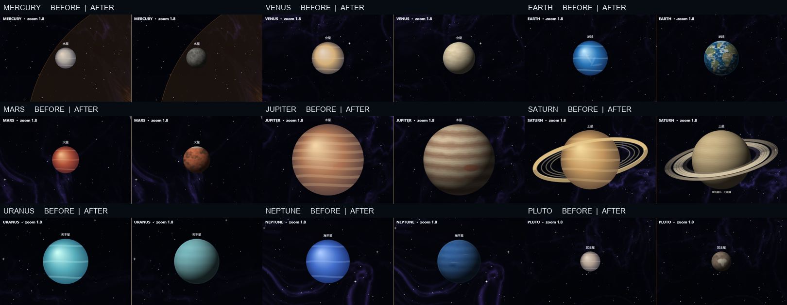

逐颗对比：

| 行星 | 修改前 | 修改后 |
| --- | --- | --- |
| 水星 | 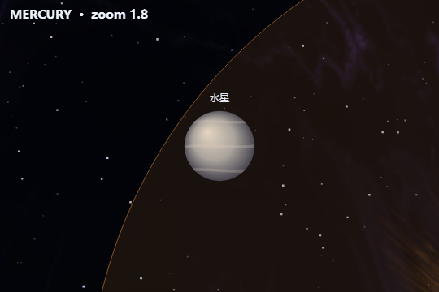 | 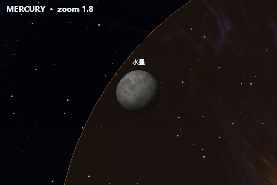 |
| 金星 | 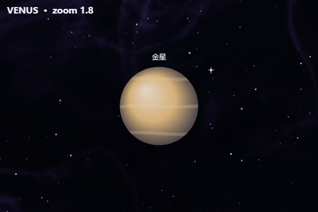 |  |
| 地球 | 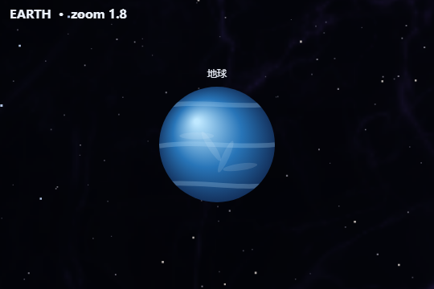 | 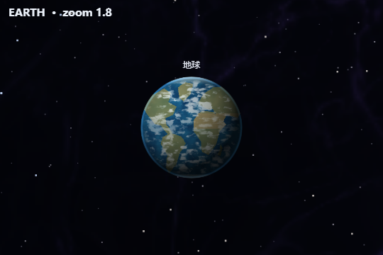 |
| 火星 | 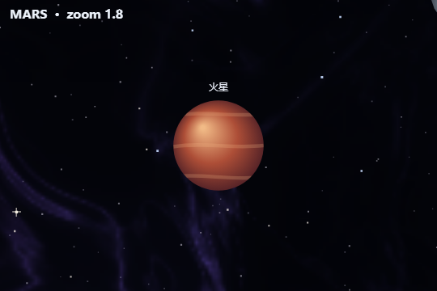 | 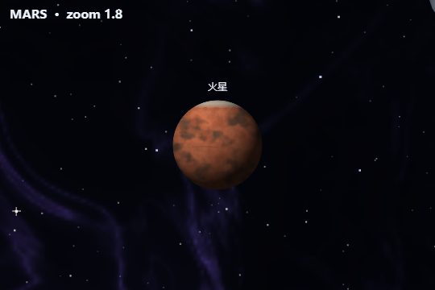 |
| 木星 | 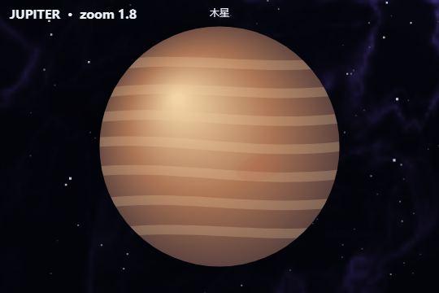 | 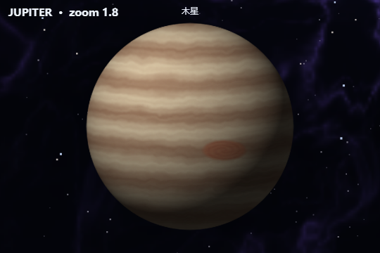 |
| 土星 | 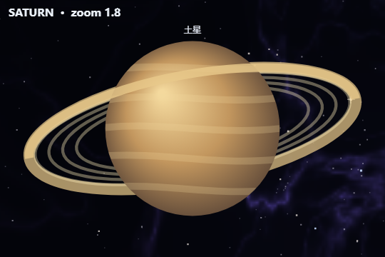 | 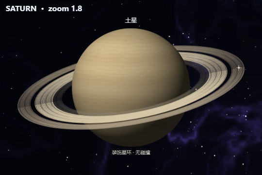 |
| 天王星 | 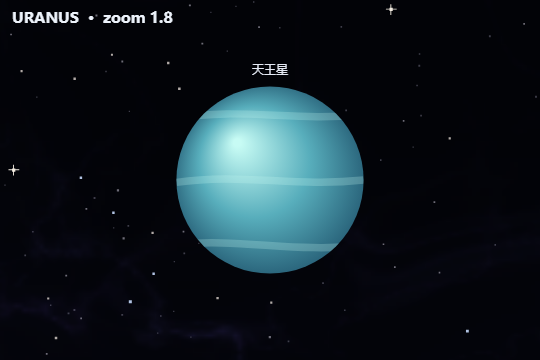 | 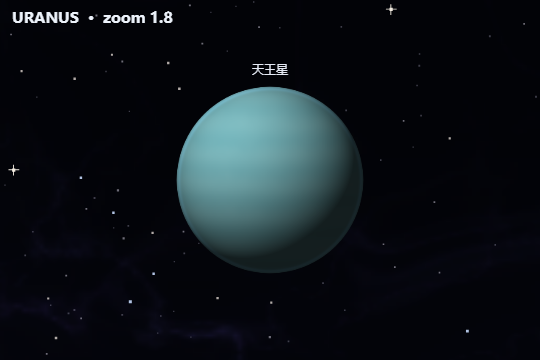 |
| 海王星 | 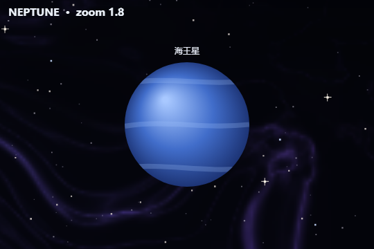 | 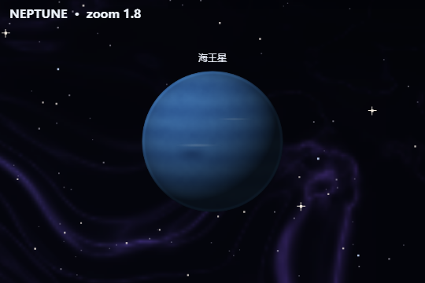 |
| 冥王星 | 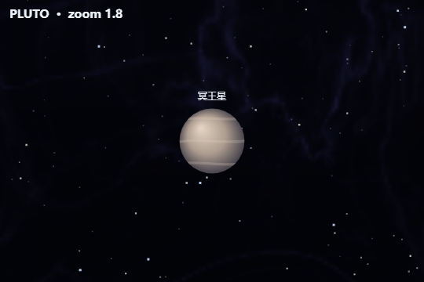 | 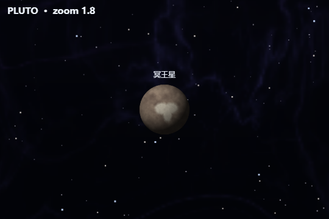 |

每档缩放的全部行星截图：

- [修改前，zoom 0.28 / 0.8 / 1.8](before-planets.png)
- [修改后，zoom 0.28 / 0.8 / 1.8](after-planets.png)
- [实际关卡同镜头，修改前](before-scene.png)
- [实际关卡同镜头，修改后](after-scene.png)

行星的 48 / 128 / 256 像素材料 LOD 根据屏幕半径选择；zoom 0.28 仍保留主色和识别轮廓，zoom 0.8 显示基础地貌，zoom 1.8 进入高细节材质。固定左上光源、相机世界变换、模拟状态与碰撞半径没有变化。

## 验证

[audit.json](audit.json) 记录了 Edge 155 / DPR 1 的浏览器实测：27 个缓存项达到固定容量后仍为 27 项，材质占用估算 4,379,648 字节；连续 2,700 次 Canvas 绘制后预算不变。九颗星体首次生成48像素预览各花费约0.9–3.5ms，详细材质由 worker 构建，累计254ms；此内存估算仅含缓存像素，不含完整浏览器堆和临时 worker 数据。切换 zoom LOD 不改变纹理采样位置。

非环行星球体半径外（允许1像素抗锯齿边缘）非透明像素为零，自动测试另逐像素验证材质单位圆外透明。土星实体仍以原半径为准，环延伸到约1.94倍半径，明确显示“装饰星环 · 无碰撞”；视口裁剪采用环的视觉外缘，不修改碰撞几何。

暂停于同一模拟时刻时完全相同，换世界坐标不改变像素，渲染前后 Body 均未修改。模拟经过30秒，地球云层变化最大每通道61/255、平均0.58/255；金星、木星与海王星也低频变化，非逐帧随机闪烁。见[地球云层0/18/48秒连续帧](cloud-motion.png)。仅云纹有小幅漂移，星体光照不旋转；这不是物理自转或气象模拟。

预热之后完整关卡 renderer 调用，开发版 Canvas 1200×720，重复一百次：修改前p50/p95为1.7/1.9ms，修改后1.7/2.0ms。此数据只计本机`render()`主线程调用，不是整帧游戏FPS，也不代表所有设备。`audit.json`里的`renderNine`只是缓存后的Canvas命令提交时间，低于计时精度时会为0，不能当作GPU栅格化或帧率测量。

[live.json](live.json) 为实际游戏UI启动、真实物理/轨迹预测/UI/渲染主循环的两次约4.2秒观察，节点力场关闭，普通画布1067×468，最近240帧：地球区60.0 FPS、主线程工作p50/p95为4.1/19.0ms；小行星带50.7 FPS、4.1/37.2ms。仍有包含预测工作的长帧，不能声称全程锁定60FPS，也未把这些长帧归因于行星纹理。截图：[地球区](live-earth.png)、[小行星带/木星区](live-belt.png)。Space开始和暂停通过，无浏览器运行时异常。本次无头Edge的Fullscreen请求未返回，因此本轮没有声称全屏验收通过；全屏实现未改动。

OFF基线逐像素比较为0差异，包括预热后的缓存和残留路径，见[验收摘要](verification.json)。

`npm run check`：本地含配乐版本40个测试文件、562项测试全部通过；TypeScript检查及生产构建通过。测试覆盖固定光照、材质透明边界、OFF不分配、不改Body/Camera、环遮挡顺序、缓存复用及worker失败回退。

发布副本（不包含本地四首配乐）另通过39个测试文件、555项测试及生产构建。实际从生产版封面进入太阳系并开始运行，新worker资源正常加载，没有调试面板、配乐控件或运行时错误；见[生产画面](production.png)和[生产记录](production.json)。生产检查仅在独立QA浏览器设置已完成教程的本地进度，没有改动游戏解锁逻辑。

素材依据、来源和NASA使用限制见 [ASSET_SOURCES.md](../ASSET_SOURCES.md)。全部绘图纹理均为程序生成；实际参考了NASA官方文字及配图描述，没有引入外部纹理或配图像素。

## 复跑

启动本地开发服务器和独立CDP浏览器后设置 `ARK_URL`（默认5177）与 `ARK_CDP_PORT`（默认9335），依次运行 `node tools/solar-planet-qa.mjs after`、`node tools/solar-planet-audit.mjs`、`node tools/solar-planet-live.mjs`。截图脚本在真实太阳系实体位置设置检查相机，不代表手动飞到每颗行星。`before`必须在旧版本执行，已有基线时会拒绝覆盖。
