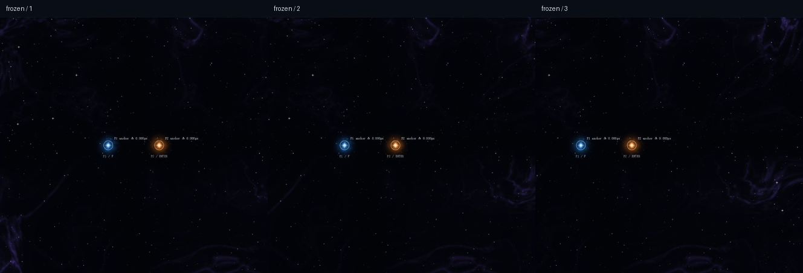
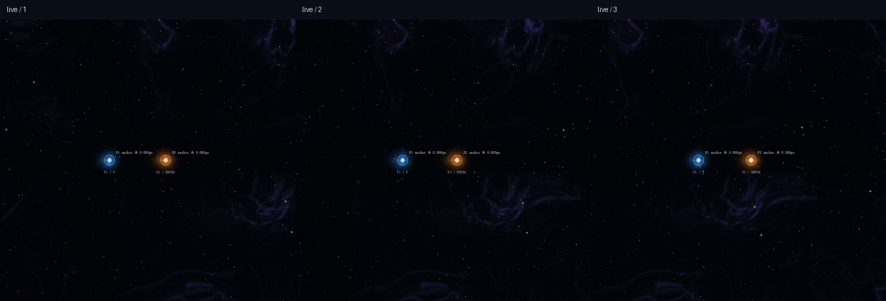

# 引力视觉实验：同一片宇宙空间

独立入口 `/vfx-demo.html`。运行 `npm install`、`npm run dev`，打开终端显示的本地地址并加上该路径。实验分支 `codex/gravity-visual-demo`，不替换主页、不合并 main。物理、碰撞、输入、摄像机和关卡源码没有改动。

WASD / F、方向键 / Enter；技能点按切换。Space 暂停、R 重置、− / + 缩放、0 复位。全屏时 V 比较、B 记录 10 秒性能、Esc 退出。复用 Keyboard、FixedClock、applyPlayerIntent、Camera 与 fieldAcceleration；Demo 不接入手柄/鼠标选择，正式游戏仍保留这些输入。

## 参考图与最新美术边界

已实际查看本地 `参考图/P1.jpg` 至 `P5.jpg`，原图保留，不上传仓库。

- P5：紫蓝细丝、暗空洞、密度和亮度不均匀的星点。通过确定性分形噪声、域扭曲、细丝脊线和尘埃衰减生成背景。
- P2：减少星点及星云密度，保留深空留白，通过背景下拉框切换。
- P3：只借鉴有机能量质感。按最新反馈，节点圆润，不再使用旋臂、风车或整体旋转纹理。
- P1 黑洞、P4 中子星仅保留下文方案，本轮不制作。

节点主体使用圆形衰减包络、笛卡尔噪声及微小局部漂移。蓝金两类各 24 帧、128²，打包为一张约 3 MiB 的图集，没有角向旋转。主体纹理半径为节点半径的 3.8 倍（当前约 49 世界单位），近场粒子最多 56 单位。定位核心始终在真实位置。蓝色粒子向内、金色向外；最多 24/12/0 颗每节点，对应高/中/低画质。只有很淡的真实历史位置短尾迹，不携带大片星云。

## 漂移根因与结构修复

旧实现存在两层问题：背景按相机 0.16 倍平移、未统一缩放，明暗形变网格固定在屏幕；即使修正投影，明暗函数仍使用各节点的相对坐标和各自 phase，导致每个节点携带独立的褶皱图案。

当前只有一套宇宙背景：

| 内容 | 坐标与更新方式 |
| --- | --- |
| 星空、遥远星系、细丝星云、尘埃 | 固定原始世界位置；相机 1:1 平移/缩放，不读取节点位置来生成图案 |
| 节点核心、有限云雾和粒子 | 节点局部或真实历史世界位置，统一 worldToScreen，只属于小范围本体 |
| 引力位移及明暗 | 在原始世界点合成两个场；固定 worldFabric(x,y) 同时用于背景纹理和明暗调制，不能以节点重新中心化 |

`sampleDisturbance()` 先叠加矢量，再统一限制视觉位移。相等反向场能抵消位移及稳态明暗。交互波只改变场的调制，起点保留发射时的世界坐标，不生成独立云图。

背景缓存每次从原始纹理重建当前可见区域，不以上一帧的扭曲结果作为输入。固定世界网格采样同一扰动函数，通过二维三角形仿射变换呈现原背景形变。明暗使用灰度 soft-light 调制已有背景，取消蓝金色的大面积覆盖云。网格选择不依赖相机，羽化缓存避免方块边缘。高档最多 48、中档 32 单元，先选择再按可见区域裁剪。

星空位移只用于渲染，绝不写回玩家或物体。相机不参与事件触发；事件仅由真实节点运动或开启力场产生，固定池最多 4 个。后台纹理生成最多一个活动任务和一个最新待处理任务；节点图集生成后销毁 Worker。

## 调试与复验

“坐标验证”展开后提供：

1. **冻结程序化动画**：固定纹理、粒子和空间起伏的时间，移除传播事件及尾迹；仍可用原来的惯性控制移动节点。用于区分坐标错误和有意动画。
2. **核心 / 场锚点**：显示投影误差、视觉时钟、累计事件数。验证的是锚点，不是把尾迹最亮像素当作中心。
3. **镜头测试 X/Y**：叠加只读观察偏移，原摄像机跟随继续运行，暂停时也可以平移。

美术参数集中于 `art.ts`、`config.ts` 和页面滑块：位移上限、明暗强度、传播速度、衰减时间、稳态起伏、星云/星点密度、曝光、节点能量、近场粒子开关。背景参数在松开滑块后生成纹理；移动节点和相机不会重新生成图案。

## 验收记录（2026-10-18）

`npm run check`：**23 个文件、415 项测试通过，生产构建通过**。新增世界纹理周期连续性、同一世界点明暗不随节点局部噪声漂移、反向场合成抵消、冻结时钟但继续读取节点位置、背景/星点统一投影、世界网格不随相机重选和圆形云雾轮廓测试。

实际在生产预览使用键盘和页面控件验证：

- 两节点静止、镜头平移；蓝移动金静止；双节点同速移动；快速反向/停下；镜头缩放；双场重叠。核心/场锚点显示误差均为 0.000 px。历史短尾迹是有意的，不作为锚点漂移。
- 最新 F 测试先冻结程序化时间。相机 X 依次 0、80、160，zoom 1.3，视觉时钟始终 1.100，累计事件始终 2。三张截图中背景、节点、场形变按同一投影移动，没有两块独立彩色云图。
- 对三个冻结画面的对应世界区域做 104/208 px 平移补偿，RGB 平均绝对差分别约 **0.635 / 0.647（0–255）**。这包含缓存重采样和抗锯齿差异，不宣称逐像素完全相同。
- 恢复动画后连续记录双节点移动的三个时间点，锚点仍对齐。变化来自真实运动、有限事件及局部粒子，星云纹理没有跟随节点重新中心化。

原始完整截图为 `unified-frozen-1/2/3.png`、`unified-live-1/2/3.png`，其他坐标检查见 `world-*.png`。`iteration-1.png`、`stage-a-*.png`、`stage-b-*.png`、`fx-*.png`、`round-*.png` 是历史对照，旋臂节点已被否定。技术基线提交 `2bca98b`、背景阶段提交 `2485918` 可用于版本比较。

最终性能采样见 `performance-unified.txt`：本机浏览器、DPR 1、实际画布 1920×1081，每档 10 秒，静止双场开启。

| 画质 | 平均 FPS | 绘制 CPU p95 | 最大 Canvas 提交 |
| --- | ---: | ---: | ---: |
| High | 165.0 | 2.60 ms | 61 |
| Medium | 164.7 | 2.40 ms | 45 |
| Low | 164.9 | 2.00 ms | 13 |

另测移动双场 High：1382×746，165 FPS、CPU p95 2.30 ms、最多 75 次提交/4 个事件。rAF FPS 和主线程绘制时间不等于 GPU 耗时。DPR 2、低端设备、10 分钟堆增长尚未实测。容量上限：4 个事件、每节点 8 个历史位置、48 个近场粒子、一张节点图集、一张背景纹理、一张最多 1600×1000 视口缓存、两个 64² 灰度羽化缓存；原始像素约 13 MiB，不等于实际显存。

## 当前限制与正式接入

### 接缝修复（2026-10-18）

删除旧纹理每边 6% 的压暗遮罩，改为边缘 12% 范围内对原材质和半幅偏移材质进行周期交叠，权重之和为 1。边界接到已有星云内容，不再接到黑色；只在后台烘焙时运行，不增加逐帧纹理计算。另将所有不透明形变三角形先绘制完，再统一叠加羽化明暗，避免后画的网格裁掉相邻柔光而留下直边。

新增恒定纹理亮度保持、两个方向边缘连续、网格与羽化绘制顺序测试；总计 **415 项测试及构建通过**。浏览器缩小到多个平铺区块并检查重叠双场，截图为 `seams-wide.png`。平铺重复仍是原型限制，但不再用暗边隐藏拼接。

背景仍为 2400 **世界单位**的有限平铺原型；极端缩小时固定星点站位采用稀疏 LOD。形变是粗网格近似，在大幅位移或高缩放时可能看到插值或视口边缘近似。内部云雾目前偏克制，P3 的丰富层次和 P5 的电影级复杂性仍未完全达到；本次优先消除贴图漂移，不宣称最终美术满意度已通过。

正式接入只应传入模拟快照与 revision，沿用固定步。让场景选择背景配置，再按宇宙区块 seed 替换有限平铺。将飞船、危险轮廓及 HUD 放在背景与节点之后，以真实关卡检查曝光。本次没有重新人工通关所有关卡；完整回归测试已执行，物理与关卡源码未修改。

## 后续计划（未实现）

- **C / P1 黑洞**：预计算二维吸积盘流动纹理，分层绘制后盘、弯曲透镜亮带、漆黑核心、前盘及细光子环。内白金、外棕金，低频湍动加窄条纹。captureRadius 不变，前盘不得遮蔽事件视界，额外验收 24/48/96 px 远景 LOD。
- **D / P4 中子星**：P4 原图标注主序星，只借鉴蓝白表面纹理，不照搬天体语义。带不规则颗粒/纤维的二维投影贴图、紧凑亮核、有限冷蓝外缘、低幅图集动画。不加入新危险光束，与节点同屏检查曝光。

## 主线接入（2026-10-18）

主渲染入口现在直接复用本 Demo 的 `VisualState`、世界锚定背景、共享时空扰动采样、节点图集和有限近场粒子。`main.ts` 只在 Level 0（First Contact / The Moving World）、Level 1（Solar Exodus）和 Level 2（Beyond the Horizon）创建视觉状态；Endless 仍走原有渲染路径。视觉状态从真实玩家位置、速度、能力开关、力场参数、相机和 `GameState.phase` 读取，不写回物理、碰撞、摄像机或任务状态。

主线天体绘制增加了程序化太阳盘面/日冕、差异化行星材质、土星前后分层星环、不规则小行星、流动虫洞入口和黑洞吸积盘/核心。土星环和所有光晕均为视觉层，碰撞仍使用 `Body.radius` 与现有危险区域；未把星环外径升级为实体碰撞。

已验证：`npm run check`（23 个测试文件、415 项测试、TypeScript 和生产构建通过）；本地浏览器打开 Level 1 和 Level 2 的 `?dev=1&fx=high`，可见深空背景、真实节点位置、行星材质和 HUD，控制台无 warning/error。未完成：尚未在本机对四档主线画面做完整 10 秒 FPS/Canvas 提交基准，也未对三关逐一人工通关；这些不能由构建和截图替代。

规范来源为仓库 `skill/space-vfx-2d` 分支的 `.agents/skills/space-vfx-2d/SKILL.md`。用户最新要求允许缓存二维纹理与近场粒子；物理隔离、确定性和性能预算继续适用。

